# Experiment results

Generated by `python scripts/run_experiment.py` from the CSVs in `experiments/results/`. The tables and
figures below are rebuilt from those files on every run; the discussion at the end was written after
reading them and quotes only numbers that appear in a table here.

## Protocol

**What runs.** Rounds run in one process, but through the platform's own code: every hospital is a
`HospitalNode` reading its own partition from disk (local training, the DP mechanism and local evaluation
are the node's code), every update passes the coordinator's `validate_update` and is combined with the
coordinator's `federated_average`, and epsilon is the platform's `account_rounds`. Only the transport is
replaced, by an in-memory one that also counts bytes. See `experiments/harness.py`.

**Comparison points that are not part of the platform.** *Local only*: each hospital trains alone.
*Centralised*: one model trained offline on the union of the same training partitions. It is usually an upper bound
for comparison: pooling the data is exactly what federated learning avoids. In 1e it was not (known
issue 5), so 1e labels it *Centralised (pooled data)*.

**Equal training effort (epoch budget rule).** With R rounds and E local epochs, every method passes over
the training data it holds R × E times, as R blocks of E epochs, with the same batch size and learning rate:
FedAvg runs E epochs at each hospital per round; local-only runs the same E epochs per round at each
hospital without averaging; centralised runs E epochs over the union per round. All three call the same
training function, which starts a fresh Adam optimiser in every block, as a hospital does at every FedAvg
round. Every training record is therefore seen R × E times under all three methods.

**Evaluation.** Each hospital scores the model on its own held-out split (25% of its records). The
confusion matrices are pooled across hospitals, as the platform does, and every metric is computed from the
pooled matrix: macro-F1 (unweighted mean of per-class F1), accuracy, and recall for each class. For the
binary EHR and X-ray tasks the F1 of the positive class is also shown, and the positive-class recall is the
"Recall adverse outcome" / "Recall finding" column. Local-only models are scored on their own hospital's
split, and separately on every hospital's split.

**No tuning on held-out data.** Every hyperparameter is the platform default (2 local epochs per round,
batch 32, Adam with learning rate 0.003, no class weighting) or is fixed in the config before the run. The
number of rounds and the F1 targets for the communication table were set in the configs before running.
Results are reported at the final round, never at the best round. The held-out splits are used only for
reporting.

**Repetitions.** Every setting is run with seeds 0, 1 and 2. The seed sets the data partition (and, for
simulated data, the generated records), the model initialisation and the training order. Values are
mean ± sample standard deviation over the three seeds.

**Models.** PyTorch: TabNet (EHR), CNN-BiLSTM (ECG), EfficientNet-B3 from random initialisation (X-ray).
Simulated data is labelled as such everywhere; it is fictional and says nothing about clinical performance.

**Reproduce.**

```bash
pip install -r backend/requirements.txt matplotlib pyyaml
python scripts/run_experiment.py experiments/configs/sim_*.yaml
MITBIH_DIR=/path/to/kaggle/heartbeat python scripts/run_experiment.py experiments/configs/mitbih_*.yaml
python scripts/run_experiment.py --report        # rebuild this file only
```

The software versions of each run are in `experiments/results/<experiment>/config.json`.

## Run time

Communication is measured in bytes and in rounds to a target F1 (see each experiment). The experiments themselves ran three at a time on a shared CPU, so their wall-clock times are not comparable and are not reported. The table below comes from a separate timing run with one process alone on the machine: 11th Gen Intel(R) Core(TM) i7-11800H @ 2.30GHz, 16 logical CPUs, PyTorch using 8 threads, no GPU. Seed 0, round 1 discarded as warm-up, mean of the next 2 rounds. A round is 2 local epochs at every hospital, plus evaluation on the held-out splits; local-only and centralised train the same amount of data per round as FedAvg.

| Experiment | Data | Training records | Method | Seconds per round |
| --- | --- | --- | --- | --- |
| mitdb_patientwise_baselines | mitdb ECG | 50,987 | Local only | 36.3 |
| mitdb_patientwise_baselines | mitdb ECG | 50,987 | FedAvg | 36.6 |
| mitdb_patientwise_baselines | mitdb ECG | 50,987 | Centralised (upper bound) | 33.6 |
| mitbih_ecg_baselines | mit-bih ECG | 18,750 | Local only | 12.3 |
| mitbih_ecg_baselines | mit-bih ECG | 18,750 | FedAvg | 12.8 |
| mitbih_ecg_baselines | mit-bih ECG | 18,750 | Centralised (upper bound) | 12.5 |
| sim_ecg_baselines | simulated ECG | 1,455 | Local only | 1.1 |
| sim_ecg_baselines | simulated ECG | 1,455 | FedAvg | 1.1 |
| sim_ecg_baselines | simulated ECG | 1,455 | Centralised (upper bound) | 1.0 |
| sim_ehr_baselines | simulated EHR | 2,490 | Local only | 1.4 |
| sim_ehr_baselines | simulated EHR | 2,490 | FedAvg | 1.5 |
| sim_ehr_baselines | simulated EHR | 2,490 | Centralised (upper bound) | 1.3 |
| sim_xray_baselines | simulated XRAY | 750 | Local only | 23.9 |
| sim_xray_baselines | simulated XRAY | 750 | FedAvg | 28.0 |
| sim_xray_baselines | simulated XRAY | 750 | Centralised (upper bound) | 22.9 |

## Part A. Real recordings: MIT-BIH heartbeats (headline results)

Everything in this part was trained and evaluated on real ECG beats from the MIT-BIH Arrhythmia Database, in two settings. **Patient-wise (1e)**: whole patients assigned to hospitals, held-out patients never seen in training (de Chazal DS1 / DS2); this is the realistic setting. **Kaggle export (1d, 2b, 3b, 5b)**: the export has no patient identifiers, so beats from one patient can sit in several hospitals and on both sides of a hospital's train / held-out split; those scores are optimistic compared with the patient-wise setting.

### 1e. Baselines, patient-wise: ECG, PhysioNet MIT-BIH Arrhythmia Database (DS1 / DS2)

Inter-patient evaluation after de Chazal et al. (2004): the 4 paced records are excluded, DS1's 22 records are dealt to the 4 hospitals as training data and DS2's 22 records as held-out data (5 or 6 whole patients per hospital and side, re-dealt for each seed). No patient appears in two hospitals or on both sides of a split. Beats are segmented at the database's reference R-peak annotations (no detector), as in de Chazal et al., and shaped like the Kaggle export (see the beat check below). All beats are used; no subsampling. 20 rounds were fixed before the first run because one round processes ~100k beats (compute); this matches the Kaggle MIT-BIH experiments, while the simulated experiments use 30. No FedProx or DP in this setting.

*Config:* `experiments/configs/mitdb_patientwise_baselines.yaml`. Data: mitdb ECG. Partition: records. 20 rounds × 2 local epochs, batch 32, learning rate 0.003. Seeds: 0, 1, 2. Values are mean ± std over seeds, final round, held-out splits pooled over hospitals.

| Variant | Method | Seeds | Macro-F1 | Accuracy | Recall N | Recall S | Recall V | Recall F |
| --- | --- | --- | --- | --- | --- | --- | --- | --- |
| default | Local only, own hospital's share | 3 | 0.371 ± 0.026 | 0.782 ± 0.037 | 0.814 ± 0.038 | 0.142 ± 0.083 | 0.808 ± 0.077 | 0.030 ± 0.043 |
| default | Local only, all hospitals' DS2 | 3 | 0.359 ± 0.009 | 0.774 ± 0.031 | 0.807 ± 0.035 | 0.104 ± 0.011 | 0.788 ± 0.025 | 0.032 ± 0.034 |
| default | FedAvg | 3 | 0.409 ± 0.007 | 0.871 ± 0.014 | 0.910 ± 0.016 | 0.043 ± 0.018 | 0.925 ± 0.015 | 0.009 ± 0.012 |
| default | Centralised (pooled data) | 3 | 0.372 ± 0.037 | 0.814 ± 0.043 | 0.848 ± 0.050 | 0.065 ± 0.026 | 0.873 ± 0.042 | 0.003 ± 0.003 |

*Centralised (pooled data)*: one model trained on all hospitals' training records together. Pooled training is usually an upper bound for federated training, but here it ended below FedAvg (known issue 5), so it is labelled by what it is.

*Local only, all hospitals' DS2*: each hospital's final local model scored on every hospital's held-out records, pooled over the four models. It answers whether one hospital's model generalises to the other hospitals' patients. A dash means the metric was not recorded for that run.

Sensitivity (Se, = recall) and positive predictivity (+P, = precision) for the S and V classes, the measures the inter-patient literature reports:

| Variant | Method | Se S | +P S | Se V | +P V |
| --- | --- | --- | --- | --- | --- |
| default | Local only, own hospital's share | 0.142 ± 0.083 | 0.066 ± 0.005 | 0.808 ± 0.077 | 0.373 ± 0.095 |
| default | Local only, all hospitals' DS2 | 0.104 ± 0.011 | 0.062 ± 0.027 | 0.788 ± 0.025 | 0.339 ± 0.024 |
| default | FedAvg | 0.043 ± 0.018 | 0.091 ± 0.025 | 0.925 ± 0.015 | 0.487 ± 0.019 |
| default | Centralised (pooled data) | 0.065 ± 0.026 | 0.132 ± 0.050 | 0.873 ± 0.042 | 0.361 ± 0.108 |

Communication (FedAvg):

| Variant | Upload per hospital per round (MB) | Download per hospital per round (MB) | Total upload, all hospitals and rounds (MB) | Rounds to macro-F1 ≥ 0.8 | Rounds to 95% of centralised macro-F1 |
| --- | --- | --- | --- | --- | --- |
| default | 0.37 ± 0.00 | 0.74 ± 0.00 | 29.7 ± 0.0 | not reached (0/3) | 2.0 ± 1.0 |

Download counts the round's base model and the aggregated model each hospital fetches to evaluate.

Partition, seed 0 (training records per class at each hospital):

| Variant | Hospital | Train | Held-out | train N | train S | train V | train F |
| --- | --- | --- | --- | --- | --- | --- | --- |
| all variants | hospital_a | 14034 | 13614 | 13224 | 19 | 782 | 9 |
| all variants | hospital_b | 13463 | 12583 | 11811 | 744 | 900 | 8 |
| all variants | hospital_c | 12245 | 11812 | 10571 | 102 | 1188 | 384 |
| all variants | hospital_d | 11245 | 11670 | 10235 | 78 | 918 | 14 |

Class F beats per hospital, training / held-out, for each seed (the rarest class; its recall rests on these few beats):

| Variant | Hospital | seed 0 | seed 1 | seed 2 |
| --- | --- | --- | --- | --- |
| default | hospital_a | 9 / 11 | 373 / 0 | 20 / 3 |
| default | hospital_b | 8 / 2 | 24 / 376 | 377 / 10 |
| default | hospital_c | 384 / 364 | 15 / 12 | 4 / 2 |
| default | hospital_d | 14 / 11 | 3 / 0 | 14 / 373 |

Records (patients) per hospital and seed. DS1 records are the hospital's training data, DS2 records its held-out data; no record appears twice:

| Seed | Hospital | DS1 records (training) | DS2 records (held-out) |
| --- | --- | --- | --- |
| 0 | hospital_a | 106, 108, 109, 114, 122, 215 | 111, 210, 214, 228, 232, 234 |
| 0 | hospital_b | 124, 201, 203, 207, 209, 220 | 100, 117, 121, 200, 212, 231 |
| 0 | hospital_c | 115, 116, 118, 205, 208 | 113, 202, 213, 219, 222 |
| 0 | hospital_d | 101, 112, 119, 223, 230 | 103, 105, 123, 221, 233 |
| 1 | hospital_a | 106, 112, 115, 116, 119, 208 | 100, 117, 212, 221, 231, 234 |
| 1 | hospital_b | 108, 114, 124, 201, 205, 220 | 111, 121, 200, 202, 213, 233 |
| 1 | hospital_c | 118, 122, 215, 223, 230 | 105, 123, 210, 214, 219 |
| 1 | hospital_d | 101, 109, 203, 207, 209 | 103, 113, 222, 228, 232 |
| 2 | hospital_a | 101, 118, 119, 124, 203, 223 | 105, 113, 200, 214, 222, 228 |
| 2 | hospital_b | 106, 114, 116, 207, 208, 220 | 111, 117, 121, 210, 221, 231 |
| 2 | hospital_c | 108, 109, 115, 209, 230 | 100, 103, 123, 202, 219 |
| 2 | hospital_d | 112, 122, 201, 205, 215 | 212, 213, 232, 233, 234 |

**Beat check** (`python -m experiments.check_mitdb_beats`, run before any training). Beats are segmented at the reference R-peak annotations, with no detector, as in de Chazal et al. (2004). Each beat runs from its R-peak for 1.2 × the median RR interval of its 10 s window, MLII lead at 125 Hz, zero-padded to 187 samples. Normalisation is per beat (min-max to [0, 1]): the Kaggle export's own data shows this (maximum exactly 1 and minimum exactly 0 in nearly every beat), although Kachuee et al. (2018) describe normalising per 10 s window. Beats extracted: DS1 N 45,841, S 943, V 3,788, F 415; DS2 N 44,233, S 1,837, V 3,221, F 388; 15 class-Q beats dropped, 52 beats skipped at record edges or in windows with a single beat.

| Class | Source | Beats | Length in samples, median (p10-p90) | Share max = 1 | Share min = 0 | Share peaking at sample 0 |
| --- | --- | --- | --- | --- | --- | --- |
| N | PhysioNet extraction | 90,074 | 111 (85-155) | 1.000 | 0.978 | 0.402 |
| N | Kaggle export | 90,589 | 106 (79-149) | 1.000 | 0.970 | 0.492 |
| S | PhysioNet extraction | 2,780 | 110 (74-127) | 1.000 | 0.982 | 0.423 |
| S | Kaggle export | 2,779 | 107 (58-187) | 0.936 | 0.973 | 0.465 |
| V | PhysioNet extraction | 7,009 | 97 (82-137) | 1.000 | 0.993 | 0.349 |
| V | Kaggle export | 7,236 | 114 (76-172) | 0.998 | 0.993 | 0.255 |
| F | PhysioNet extraction | 803 | 84 (82-91) | 1.000 | 0.938 | 0.598 |
| F | Kaggle export | 803 | 78 (69-87) | 1.000 | 0.766 | 0.669 |

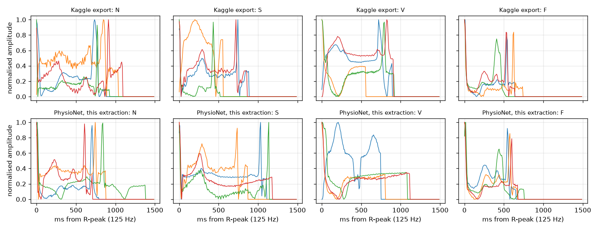

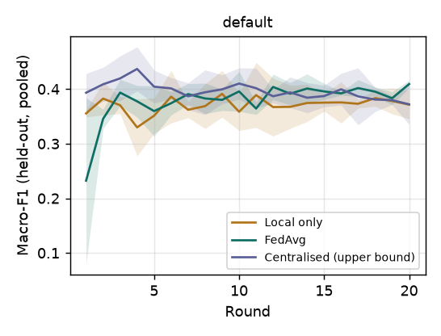

### 1f. Patient-wise with RR-interval inputs: ECG, PhysioNet MIT-BIH Arrhythmia Database (DS1 / DS2)

Added after seeing the 1e results, motivated by the literature: de Chazal et al. (2004) classify beats with RR-interval features, and in 1e, where the model sees one beat without its own RR interval, S beats were almost never detected. 1e stays as reported; 1f does not replace it. Fixed before any 1f run: identical to 1e (the same DS1 / DS2 records dealt to the same hospitals per seed, seeds 0-2, 20 rounds x 2 local epochs, batch 32, learning rate 0.003, local only, FedAvg and pooled training, no FedProx or DP, the same evaluation, final round reported even if a curve peaks earlier), except that each beat also gets three RR-interval inputs from the reference annotations: pre-RR, post-RR and the local average RR over the 10 surrounding intervals, each divided by the record's own average RR (experiments/mitdb.py, rr_features). The model is the same CNN-BiLSTM with the three RR inputs concatenated to its mean-pooled BiLSTM output (after dropout) before the final linear layer, which grows from 128 to 131 inputs (CNN-BiLSTM+RR, used only by the experiment harness). The same training order as 1e (round ids named after 1e) and the same 5 PyTorch threads, so each seed is a paired comparison with the same seed of 1e; a check before the run reproduced 1e's seed 0, round 1 FedAvg score exactly. Simplification: dividing by the record's average RR uses beats that come after the current one (and post-RR uses the next beat); a deployed system would use a running average of past beats only.

*Config:* `experiments/configs/mitdb_patientwise_rr.yaml`. Data: mitdb ECG. Partition: records. 20 rounds × 2 local epochs, batch 32, learning rate 0.003. Seeds: 0, 1, 2. Values are mean ± std over seeds, final round, held-out splits pooled over hospitals.

| Variant | Method | Seeds | Macro-F1 | Accuracy | Recall N | Recall S | Recall V | Recall F |
| --- | --- | --- | --- | --- | --- | --- | --- | --- |
| default | Local only, own hospital's share | 3 | 0.374 ± 0.024 | 0.789 ± 0.053 | 0.819 ± 0.058 | 0.126 ± 0.081 | 0.846 ± 0.072 | 0.044 ± 0.074 |
| default | Local only, all hospitals' DS2 | 3 | 0.364 ± 0.036 | 0.785 ± 0.048 | 0.817 ± 0.053 | 0.114 ± 0.011 | 0.820 ± 0.003 | 0.028 ± 0.022 |
| default | FedAvg | 3 | 0.477 ± 0.013 | 0.892 ± 0.002 | 0.925 ± 0.004 | 0.190 ± 0.029 | 0.940 ± 0.019 | 0.026 ± 0.017 |
| default | Centralised (pooled data) | 3 | 0.414 ± 0.013 | 0.850 ± 0.007 | 0.885 ± 0.009 | 0.125 ± 0.028 | 0.883 ± 0.004 | 0.015 ± 0.018 |

*Centralised (pooled data)*: as in 1e, one model trained on all hospitals' training records together, labelled as in 1e so that the paired comparison below lines up.

*Local only, all hospitals' DS2*: each hospital's final local model scored on every hospital's held-out records, pooled over the four models. It answers whether one hospital's model generalises to the other hospitals' patients. A dash means the metric was not recorded for that run.

Predicted-class distribution (share of held-out beats assigned to each class, final round):

| Variant | Method | Predicted N | Predicted S | Predicted V | Predicted F |
| --- | --- | --- | --- | --- | --- |
| default | Local only, own hospital's share | 0.766 ± 0.045 | 0.047 ± 0.037 | 0.163 ± 0.021 | 0.024 ± 0.007 |
| default | Local only, all hospitals' DS2 | 0.763 ± 0.051 | 0.044 ± 0.015 | 0.174 ± 0.036 | 0.018 ± 0.005 |
| default | FedAvg | 0.860 ± 0.006 | 0.017 ± 0.005 | 0.113 ± 0.007 | 0.009 ± 0.004 |
| default | Centralised (pooled data) | 0.824 ± 0.010 | 0.015 ± 0.004 | 0.147 ± 0.017 | 0.014 ± 0.013 |

Sensitivity (Se, = recall) and positive predictivity (+P, = precision) for the S and V classes, the measures the inter-patient literature reports:

| Variant | Method | Se S | +P S | Se V | +P V |
| --- | --- | --- | --- | --- | --- |
| default | Local only, own hospital's share | 0.126 ± 0.081 | 0.109 ± 0.067 | 0.846 ± 0.072 | 0.341 ± 0.072 |
| default | Local only, all hospitals' DS2 | 0.114 ± 0.011 | 0.108 ± 0.057 | 0.820 ± 0.003 | 0.315 ± 0.070 |
| default | FedAvg | 0.190 ± 0.029 | 0.413 ± 0.073 | 0.940 ± 0.019 | 0.540 ± 0.038 |
| default | Centralised (pooled data) | 0.125 ± 0.028 | 0.313 ± 0.037 | 0.883 ± 0.004 | 0.393 ± 0.048 |

Paired comparison with 1e: the same seed, the same records at each hospital and the same training order, so each row is this experiment minus 1e for one seed (positive = higher here), then the mean and std of those differences:

| Method | Seed | Δ Macro-F1 | Δ Se S | Δ +P S | Δ Se V | Δ +P V |
| --- | --- | --- | --- | --- | --- | --- |
| Local only, own hospital's share | seed 0 | +0.027 | -0.015 | +0.006 | +0.037 | +0.064 |
| Local only, own hospital's share | seed 1 | -0.037 | -0.024 | +0.006 | +0.025 | -0.145 |
| Local only, own hospital's share | seed 2 | +0.019 | -0.009 | +0.116 | +0.050 | -0.016 |
| Local only, own hospital's share | mean ± std | **+0.003 ± 0.035** | **-0.016 ± 0.008** | **+0.043 ± 0.064** | **+0.037 ± 0.012** | **-0.032 ± 0.105** |
| Local only, all hospitals' DS2 | seed 0 | +0.035 | +0.025 | +0.083 | +0.001 | +0.053 |
| Local only, all hospitals' DS2 | seed 1 | -0.016 | +0.012 | +0.014 | +0.039 | -0.054 |
| Local only, all hospitals' DS2 | seed 2 | -0.006 | -0.007 | +0.042 | +0.055 | -0.073 |
| Local only, all hospitals' DS2 | mean ± std | **+0.004 ± 0.027** | **+0.010 ± 0.016** | **+0.046 ± 0.035** | **+0.032 ± 0.028** | **-0.025 ± 0.068** |
| FedAvg | seed 0 | +0.079 | +0.188 | +0.387 | +0.029 | +0.017 |
| FedAvg | seed 1 | +0.066 | +0.152 | +0.253 | +0.010 | +0.090 |
| FedAvg | seed 2 | +0.058 | +0.102 | +0.328 | +0.007 | +0.050 |
| FedAvg | mean ± std | **+0.068 ± 0.010** | **+0.147 ± 0.043** | **+0.323 ± 0.067** | **+0.015 ± 0.012** | **+0.052 ± 0.036** |
| Centralised (pooled data) | seed 0 | +0.064 | +0.095 | +0.133 | -0.025 | +0.089 |
| Centralised (pooled data) | seed 1 | +0.045 | +0.040 | +0.225 | -0.008 | +0.038 |
| Centralised (pooled data) | seed 2 | +0.016 | +0.046 | +0.185 | +0.062 | -0.031 |
| Centralised (pooled data) | mean ± std | **+0.042 ± 0.024** | **+0.060 ± 0.030** | **+0.181 ± 0.046** | **+0.010 ± 0.046** | **+0.032 ± 0.060** |

Communication (FedAvg):

| Variant | Upload per hospital per round (MB) | Download per hospital per round (MB) | Total upload, all hospitals and rounds (MB) | Rounds to macro-F1 ≥ 0.8 | Rounds to 95% of centralised macro-F1 |
| --- | --- | --- | --- | --- | --- |
| default | 0.37 ± 0.00 | 0.74 ± 0.00 | 29.7 ± 0.0 | not reached (0/3) | 4.7 ± 2.1 |

Download counts the round's base model and the aggregated model each hospital fetches to evaluate.

Partition, seed 0 (training records per class at each hospital):

| Variant | Hospital | Train | Held-out | train N | train S | train V | train F |
| --- | --- | --- | --- | --- | --- | --- | --- |
| all variants | hospital_a | 14034 | 13614 | 13224 | 19 | 782 | 9 |
| all variants | hospital_b | 13463 | 12583 | 11811 | 744 | 900 | 8 |
| all variants | hospital_c | 12245 | 11812 | 10571 | 102 | 1188 | 384 |
| all variants | hospital_d | 11245 | 11670 | 10235 | 78 | 918 | 14 |

Class F beats per hospital, training / held-out, for each seed (the rarest class; its recall rests on these few beats):

| Variant | Hospital | seed 0 | seed 1 | seed 2 |
| --- | --- | --- | --- | --- |
| default | hospital_a | 9 / 11 | 373 / 0 | 20 / 3 |
| default | hospital_b | 8 / 2 | 24 / 376 | 377 / 10 |
| default | hospital_c | 384 / 364 | 15 / 12 | 4 / 2 |
| default | hospital_d | 14 / 11 | 3 / 0 | 14 / 373 |

Records (patients) per hospital and seed. DS1 records are the hospital's training data, DS2 records its held-out data; no record appears twice:

| Seed | Hospital | DS1 records (training) | DS2 records (held-out) |
| --- | --- | --- | --- |
| 0 | hospital_a | 106, 108, 109, 114, 122, 215 | 111, 210, 214, 228, 232, 234 |
| 0 | hospital_b | 124, 201, 203, 207, 209, 220 | 100, 117, 121, 200, 212, 231 |
| 0 | hospital_c | 115, 116, 118, 205, 208 | 113, 202, 213, 219, 222 |
| 0 | hospital_d | 101, 112, 119, 223, 230 | 103, 105, 123, 221, 233 |
| 1 | hospital_a | 106, 112, 115, 116, 119, 208 | 100, 117, 212, 221, 231, 234 |
| 1 | hospital_b | 108, 114, 124, 201, 205, 220 | 111, 121, 200, 202, 213, 233 |
| 1 | hospital_c | 118, 122, 215, 223, 230 | 105, 123, 210, 214, 219 |
| 1 | hospital_d | 101, 109, 203, 207, 209 | 103, 113, 222, 228, 232 |
| 2 | hospital_a | 101, 118, 119, 124, 203, 223 | 105, 113, 200, 214, 222, 228 |
| 2 | hospital_b | 106, 114, 116, 207, 208, 220 | 111, 117, 121, 210, 221, 231 |
| 2 | hospital_c | 108, 109, 115, 209, 230 | 100, 103, 123, 202, 219 |
| 2 | hospital_d | 112, 122, 201, 205, 215 | 212, 213, 232, 233, 234 |

**Beat check** (`python -m experiments.check_mitdb_beats`, run before any training). Beats are segmented at the reference R-peak annotations, with no detector, as in de Chazal et al. (2004). Each beat runs from its R-peak for 1.2 × the median RR interval of its 10 s window, MLII lead at 125 Hz, zero-padded to 187 samples. Normalisation is per beat (min-max to [0, 1]): the Kaggle export's own data shows this (maximum exactly 1 and minimum exactly 0 in nearly every beat), although Kachuee et al. (2018) describe normalising per 10 s window. Beats extracted: DS1 N 45,841, S 943, V 3,788, F 415; DS2 N 44,233, S 1,837, V 3,221, F 388; 15 class-Q beats dropped, 52 beats skipped at record edges or in windows with a single beat.

| Class | Source | Beats | Length in samples, median (p10-p90) | Share max = 1 | Share min = 0 | Share peaking at sample 0 |
| --- | --- | --- | --- | --- | --- | --- |
| N | PhysioNet extraction | 90,074 | 111 (85-155) | 1.000 | 0.978 | 0.402 |
| N | Kaggle export | 90,589 | 106 (79-149) | 1.000 | 0.970 | 0.492 |
| S | PhysioNet extraction | 2,780 | 110 (74-127) | 1.000 | 0.982 | 0.423 |
| S | Kaggle export | 2,779 | 107 (58-187) | 0.936 | 0.973 | 0.465 |
| V | PhysioNet extraction | 7,009 | 97 (82-137) | 1.000 | 0.993 | 0.349 |
| V | Kaggle export | 7,236 | 114 (76-172) | 0.998 | 0.993 | 0.255 |
| F | PhysioNet extraction | 803 | 84 (82-91) | 1.000 | 0.938 | 0.598 |
| F | Kaggle export | 803 | 78 (69-87) | 1.000 | 0.766 | 0.669 |


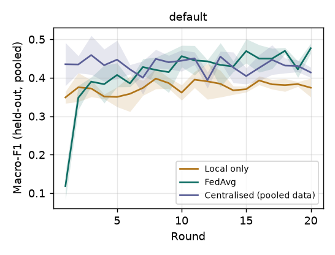

### 1d. Baselines: ECG, MIT-BIH (real recordings)

MIT-BIH heartbeats split across four hospitals with a Dirichlet label split, alpha = 1.0 (the default of scripts/prepare_real_data.py). The export has no patient identifiers, so beats of one patient can fall in several hospitals and on both sides of a hospital's train / held-out split; scores are therefore optimistic compared with a patient-wise split.

*Config:* `experiments/configs/mitbih_ecg_baselines.yaml`. Data: mit-bih ECG, stratified subsample of 25000 records. Partition: dirichlet (alpha = 1.0). 20 rounds × 2 local epochs, batch 32, learning rate 0.003. Seeds: 0, 1, 2. Values are mean ± std over seeds, final round, held-out splits pooled over hospitals.

Records available in mitbih_train.csv + mitbih_test.csv (class Q dropped): 101,407 (N 90,589, S 2,779, V 7,236, F 803). Used: 25,000 (N 22,333, S 685, V 1,784, F 198), a stratified by class, without replacement subsample drawn once with seed 0 and shared by every MIT-BIH experiment and seed.

| Variant | Method | Seeds | Macro-F1 | Accuracy | Recall N | Recall S | Recall V | Recall F |
| --- | --- | --- | --- | --- | --- | --- | --- | --- |
| default | Local only, own hospital's share | 3 | 0.826 ± 0.021 | 0.972 ± 0.008 | 0.991 ± 0.003 | 0.662 ± 0.069 | 0.900 ± 0.047 | 0.648 ± 0.085 |
| default | Local only, all hospitals' held-out data | 3 | 0.647 ± 0.129 | - | - | - | - | - |
| default | FedAvg | 3 | 0.842 ± 0.023 | 0.974 ± 0.003 | 0.994 ± 0.001 | 0.553 ± 0.100 | 0.927 ± 0.039 | 0.743 ± 0.080 |
| default | Centralised (upper bound) | 3 | 0.881 ± 0.021 | 0.980 ± 0.000 | 0.993 ± 0.002 | 0.734 ± 0.065 | 0.952 ± 0.013 | 0.717 ± 0.094 |

*Local only, all hospitals' held-out data*: each hospital's final local model scored on every hospital's held-out records, pooled over the four models. It answers whether one hospital's model generalises to the other hospitals' patients. A dash means the metric was not recorded for that run.

Communication (FedAvg):

| Variant | Upload per hospital per round (MB) | Download per hospital per round (MB) | Total upload, all hospitals and rounds (MB) | Rounds to macro-F1 ≥ 0.8 | Rounds to 95% of centralised macro-F1 |
| --- | --- | --- | --- | --- | --- |
| default | 0.37 ± 0.00 | 0.74 ± 0.00 | 29.7 ± 0.0 | 12.7 ± 4.5 | 14.5 ± 0.7 (2/3 seeds) |

Download counts the round's base model and the aggregated model each hospital fetches to evaluate.

Partition, seed 0 (training records per class at each hospital):

| Variant | Hospital | Train | Held-out | train N | train S | train V | train F |
| --- | --- | --- | --- | --- | --- | --- | --- |
| all variants | hospital_a | 601 | 200 | 27 | 304 | 253 | 17 |
| all variants | hospital_b | 4669 | 1556 | 4528 | 34 | 21 | 86 |
| all variants | hospital_c | 728 | 243 | 388 | 37 | 302 | 1 |
| all variants | hospital_d | 12752 | 4251 | 11785 | 141 | 778 | 48 |

Class F beats per hospital, training / held-out, for each seed (the rarest class; its recall rests on these few beats):

| Variant | Hospital | seed 0 | seed 1 | seed 2 |
| --- | --- | --- | --- | --- |
| default | hospital_a | 17 / 6 | 16 / 4 | 51 / 17 |
| default | hospital_b | 86 / 21 | 10 / 5 | 15 / 7 |
| default | hospital_c | 1 / 1 | 75 / 32 | 62 / 26 |
| default | hospital_d | 48 / 18 | 42 / 14 | 16 / 4 |

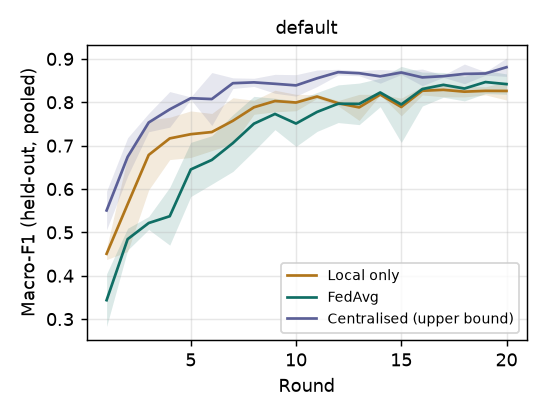

### 2b. Non-IID label skew: ECG, MIT-BIH

Same records, re-split with Dirichlet alpha = inf (even random), 1.0 and 0.1.

*Config:* `experiments/configs/mitbih_ecg_noniid.yaml`. Data: mit-bih ECG, stratified subsample of 25000 records. Partition: dirichlet (alpha = None). 20 rounds × 2 local epochs, batch 32, learning rate 0.003. Seeds: 0, 1, 2. Values are mean ± std over seeds, final round, held-out splits pooled over hospitals.

Records available in mitbih_train.csv + mitbih_test.csv (class Q dropped): 101,407 (N 90,589, S 2,779, V 7,236, F 803). Used: 25,000 (N 22,333, S 685, V 1,784, F 198), a stratified by class, without replacement subsample drawn once with seed 0 and shared by every MIT-BIH experiment and seed.

| Variant | Method | Seeds | Macro-F1 | Accuracy | Recall N | Recall S | Recall V | Recall F |
| --- | --- | --- | --- | --- | --- | --- | --- | --- |
| alpha=inf | Local only, own hospital's share | 3 | 0.784 ± 0.010 | 0.965 ± 0.002 | 0.987 ± 0.001 | 0.548 ± 0.025 | 0.880 ± 0.026 | 0.611 ± 0.011 |
| alpha=inf | Local only, all hospitals' held-out data | 3 | 0.769 ± 0.007 | - | - | - | - | - |
| alpha=inf | FedAvg | 3 | 0.834 ± 0.005 | 0.973 ± 0.002 | 0.988 ± 0.002 | 0.668 ± 0.033 | 0.941 ± 0.016 | 0.688 ± 0.004 |
| alpha=inf | Centralised (upper bound) | 3 | 0.879 ± 0.004 | 0.982 ± 0.001 | 0.994 ± 0.000 | 0.744 ± 0.034 | 0.949 ± 0.013 | 0.761 ± 0.037 |
| alpha=1.0 | Local only, own hospital's share | 3 | 0.826 ± 0.021 | 0.972 ± 0.008 | 0.991 ± 0.003 | 0.662 ± 0.069 | 0.900 ± 0.047 | 0.648 ± 0.085 |
| alpha=1.0 | Local only, all hospitals' held-out data | 3 | 0.647 ± 0.129 | - | - | - | - | - |
| alpha=1.0 | FedAvg | 3 | 0.829 ± 0.036 | 0.974 ± 0.005 | 0.995 ± 0.002 | 0.526 ± 0.107 | 0.918 ± 0.018 | 0.709 ± 0.032 |
| alpha=1.0 | Centralised (upper bound) | 3 | 0.881 ± 0.021 | 0.980 ± 0.000 | 0.993 ± 0.002 | 0.734 ± 0.065 | 0.952 ± 0.013 | 0.717 ± 0.094 |
| alpha=0.1 | Local only, own hospital's share | 3 | 0.922 ± 0.027 | 0.989 ± 0.005 | 0.995 ± 0.003 | 0.923 ± 0.069 | 0.955 ± 0.015 | 0.869 ± 0.033 |
| alpha=0.1 | Local only, all hospitals' held-out data | 3 | 0.362 ± 0.105 | - | - | - | - | - |
| alpha=0.1 | FedAvg | 3 | 0.430 ± 0.079 | 0.938 ± 0.033 | 0.997 ± 0.002 | 0.000 ± 0.000 | 0.628 ± 0.545 | 0.270 ± 0.467 |
| alpha=0.1 | Centralised (upper bound) | 3 | 0.850 ± 0.028 | 0.979 ± 0.004 | 0.994 ± 0.003 | 0.697 ± 0.039 | 0.938 ± 0.023 | 0.633 ± 0.033 |

*Local only, all hospitals' held-out data*: each hospital's final local model scored on every hospital's held-out records, pooled over the four models. It answers whether one hospital's model generalises to the other hospitals' patients. A dash means the metric was not recorded for that run.

Communication (FedAvg):

| Variant | Upload per hospital per round (MB) | Download per hospital per round (MB) | Total upload, all hospitals and rounds (MB) | Rounds to macro-F1 ≥ 0.8 | Rounds to 95% of centralised macro-F1 |
| --- | --- | --- | --- | --- | --- |
| alpha=inf | 0.37 ± 0.00 | 0.74 ± 0.00 | 29.7 ± 0.0 | 9.7 ± 1.2 | 12.0 ± 0.0 (1/3 seeds) |
| alpha=1.0 | 0.37 ± 0.00 | 0.74 ± 0.00 | 29.7 ± 0.0 | 13.7 ± 5.0 | 16.0 ± 4.2 (2/3 seeds) |
| alpha=0.1 | 0.37 ± 0.00 | 0.74 ± 0.00 | 27.2 ± 4.3 | not reached (0/3) | not reached (0/3) |

Download counts the round's base model and the aggregated model each hospital fetches to evaluate.

Partition, seed 0 (training records per class at each hospital):

| Variant | Hospital | Train | Held-out | train N | train S | train V | train F |
| --- | --- | --- | --- | --- | --- | --- | --- |
| alpha=inf | hospital_a | 4688 | 1562 | 4205 | 116 | 335 | 32 |
| alpha=inf | hospital_b | 4688 | 1562 | 4193 | 120 | 333 | 42 |
| alpha=inf | hospital_c | 4688 | 1562 | 4189 | 136 | 331 | 32 |
| alpha=inf | hospital_d | 4688 | 1562 | 4178 | 143 | 330 | 37 |
| alpha=1.0 | hospital_a | 601 | 200 | 27 | 304 | 253 | 17 |
| alpha=1.0 | hospital_b | 4669 | 1556 | 4528 | 34 | 21 | 86 |
| alpha=1.0 | hospital_c | 728 | 243 | 388 | 37 | 302 | 1 |
| alpha=1.0 | hospital_d | 12752 | 4251 | 11785 | 141 | 778 | 48 |
| alpha=0.1 | hospital_a | 529 | 176 | 0 | 511 | 18 | 0 |
| alpha=0.1 | hospital_b | 1166 | 388 | 0 | 0 | 1016 | 150 |
| alpha=0.1 | hospital_c | 17053 | 5684 | 16761 | 0 | 292 | 0 |

Class F beats per hospital, training / held-out, for each seed (the rarest class; its recall rests on these few beats):

| Variant | Hospital | seed 0 | seed 1 | seed 2 |
| --- | --- | --- | --- | --- |
| alpha=inf | hospital_a | 32 / 15 | 44 / 14 | 47 / 12 |
| alpha=inf | hospital_b | 42 / 15 | 31 / 7 | 32 / 14 |
| alpha=inf | hospital_c | 32 / 10 | 46 / 8 | 32 / 7 |
| alpha=inf | hospital_d | 37 / 15 | 36 / 12 | 42 / 12 |
| alpha=1.0 | hospital_a | 17 / 6 | 16 / 4 | 51 / 17 |
| alpha=1.0 | hospital_b | 86 / 21 | 10 / 5 | 15 / 7 |
| alpha=1.0 | hospital_c | 1 / 1 | 75 / 32 | 62 / 26 |
| alpha=1.0 | hospital_d | 48 / 18 | 42 / 14 | 16 / 4 |
| alpha=0.1 | hospital_a | 0 / 0 | 0 / 0 | 120 / 40 |
| alpha=0.1 | hospital_b | 150 / 47 | 156 / 41 | 1 / 0 |
| alpha=0.1 | hospital_c | 0 / 0 | 0 / 0 | 0 / 0 |
| alpha=0.1 | hospital_d | excluded | 0 / 1 | 27 / 10 |

Hospitals that sat a run out (too few records to train): alpha=0.1 seed 0 hospital_d (received 4 record(s))

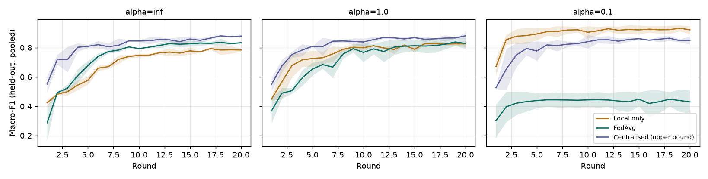

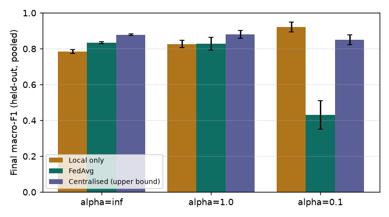

### 3b. Privacy cost: ECG, MIT-BIH

Platform DP prototype (client-level: noise sigma x clip_norm on every coordinate of a hospital's update), clip norm 1.0 fixed. The noise grid was fixed before any MIT-BIH run and spans levels where epsilon is far too large to mean anything, to show where utility is lost. Dirichlet alpha = 1.0 split.

*Config:* `experiments/configs/mitbih_ecg_privacy.yaml`. Data: mit-bih ECG, stratified subsample of 25000 records. Partition: dirichlet (alpha = 1.0). 20 rounds × 2 local epochs, batch 32, learning rate 0.003. Seeds: 0, 1, 2. Values are mean ± std over seeds, final round, held-out splits pooled over hospitals.

Records available in mitbih_train.csv + mitbih_test.csv (class Q dropped): 101,407 (N 90,589, S 2,779, V 7,236, F 803). Used: 25,000 (N 22,333, S 685, V 1,784, F 198), a stratified by class, without replacement subsample drawn once with seed 0 and shared by every MIT-BIH experiment and seed.

| Variant | Method | Seeds | Macro-F1 | Accuracy | Recall N | Recall S | Recall V | Recall F |
| --- | --- | --- | --- | --- | --- | --- | --- | --- |
| sigma=0 (no DP) | FedAvg | 3 | 0.839 ± 0.016 | 0.975 ± 0.002 | 0.993 ± 0.002 | 0.580 ± 0.083 | 0.936 ± 0.016 | 0.688 ± 0.035 |
| sigma=0.001 | FedAvg | 3 | 0.048 ± 0.026 | 0.098 ± 0.048 | 0.029 ± 0.051 | 0.000 ± 0.000 | 1.000 ± 0.000 | 0.000 ± 0.000 |
| sigma=0.003 | FedAvg | 3 | 0.064 ± 0.036 | 0.128 ± 0.069 | 0.064 ± 0.074 | 0.000 ± 0.000 | 1.000 ± 0.000 | 0.000 ± 0.000 |
| sigma=0.01 | FedAvg | 3 | 0.056 ± 0.038 | 0.102 ± 0.049 | 0.034 ± 0.058 | 0.000 ± 0.000 | 1.000 ± 0.000 | 0.022 ± 0.038 |
| sigma=0.03 | FedAvg | 3 | 0.089 ± 0.052 | 0.180 ± 0.104 | 0.122 ± 0.113 | 0.000 ± 0.000 | 1.000 ± 0.000 | 0.000 ± 0.000 |
| sigma=0.1 | FedAvg | 3 | 0.247 ± 0.011 | 0.876 ± 0.024 | 0.979 ± 0.036 | 0.000 ± 0.000 | 0.046 ± 0.057 | 0.000 ± 0.000 |
| sigma=1.0 | FedAvg | 3 | 0.175 ± 0.104 | 0.597 ± 0.456 | 0.643 ± 0.557 | 0.032 ± 0.032 | 0.318 ± 0.550 | 0.006 ± 0.010 |

Privacy accounting (platform's zCDP bound, per hospital, over all rounds):

| Variant | ε | Macro-F1 | Accuracy | Median update norm before clipping | Share of updates clipped |
| --- | --- | --- | --- | --- | --- |
| sigma=0 (no DP) | ∞ | 0.839 ± 0.016 | 0.975 ± 0.002 | 11.33 ± 0.86 | 0.00 ± 0.00 |
| sigma=0.001 | 10021459.66 ± 0.00 | 0.048 ± 0.026 | 0.098 ± 0.048 | 11.05 ± 1.23 | 1.00 ± 0.00 |
| sigma=0.003 | 1118264.33 ± 0.00 | 0.064 ± 0.036 | 0.128 ± 0.069 | 10.99 ± 1.57 | 1.00 ± 0.00 |
| sigma=0.01 | 102145.97 ± 0.00 | 0.056 ± 0.038 | 0.102 ± 0.049 | 10.87 ± 1.54 | 1.00 ± 0.00 |
| sigma=0.03 | 11826.43 ± 0.00 | 0.089 ± 0.052 | 0.180 ± 0.104 | 10.90 ± 1.63 | 1.00 ± 0.00 |
| sigma=0.1 | 1214.60 ± 0.00 | 0.247 ± 0.011 | 0.876 ± 0.024 | 12.79 ± 1.13 | 1.00 ± 0.00 |
| sigma=1.0 | 31.46 ± 0.00 | 0.175 ± 0.104 | 0.597 ± 0.456 | 13.63 ± 2.55 | 1.00 ± 0.00 |

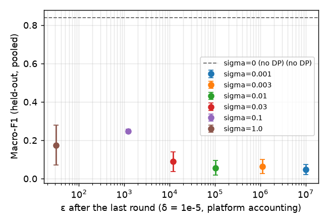

Communication (FedAvg):

| Variant | Upload per hospital per round (MB) | Download per hospital per round (MB) | Total upload, all hospitals and rounds (MB) | Rounds to macro-F1 ≥ 0.8 | Rounds to 95% of centralised macro-F1 |
| --- | --- | --- | --- | --- | --- |
| sigma=0 (no DP) | 0.37 ± 0.00 | 0.74 ± 0.00 | 29.7 ± 0.0 | 13.0 ± 4.0 | - |
| sigma=0.001 | 0.37 ± 0.00 | 0.74 ± 0.00 | 29.7 ± 0.0 | not reached (0/3) | - |
| sigma=0.003 | 0.37 ± 0.00 | 0.74 ± 0.00 | 29.7 ± 0.0 | not reached (0/3) | - |
| sigma=0.01 | 0.37 ± 0.00 | 0.74 ± 0.00 | 29.7 ± 0.0 | not reached (0/3) | - |
| sigma=0.03 | 0.37 ± 0.00 | 0.74 ± 0.00 | 29.7 ± 0.0 | not reached (0/3) | - |
| sigma=0.1 | 0.37 ± 0.00 | 0.74 ± 0.00 | 29.7 ± 0.0 | not reached (0/3) | - |
| sigma=1.0 | 0.37 ± 0.00 | 0.74 ± 0.00 | 29.7 ± 0.0 | not reached (0/3) | - |

Download counts the round's base model and the aggregated model each hospital fetches to evaluate.

Partition, seed 0 (training records per class at each hospital):

| Variant | Hospital | Train | Held-out | train N | train S | train V | train F |
| --- | --- | --- | --- | --- | --- | --- | --- |
| all variants | hospital_a | 601 | 200 | 27 | 304 | 253 | 17 |
| all variants | hospital_b | 4669 | 1556 | 4528 | 34 | 21 | 86 |
| all variants | hospital_c | 728 | 243 | 388 | 37 | 302 | 1 |
| all variants | hospital_d | 12752 | 4251 | 11785 | 141 | 778 | 48 |

Class F beats per hospital, training / held-out, for each seed (the rarest class; its recall rests on these few beats):

| Variant | Hospital | seed 0 | seed 1 | seed 2 |
| --- | --- | --- | --- | --- |
| all variants | hospital_a | 17 / 6 | 16 / 4 | 51 / 17 |
| all variants | hospital_b | 86 / 21 | 10 / 5 | 15 / 7 |
| all variants | hospital_c | 1 / 1 | 75 / 32 | 62 / 26 |
| all variants | hospital_d | 48 / 18 | 42 / 14 | 16 / 4 |

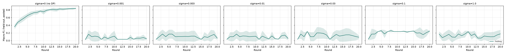

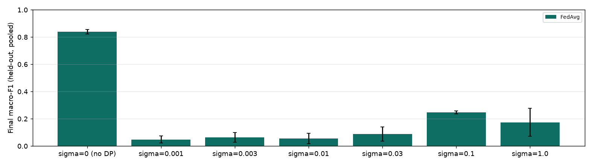

### Diagnostic for known issue 4: clipping and batch-norm statistics, ECG, MIT-BIH (one seed)

A diagnostic, not a result: one seed (0), FedAvg only, added after the privacy runs (3b) to test one hypothesis about known issue 4. With DP on, the platform clips the trainable weights of each update (about 11-fold on this data) but sends batch-norm running statistics unclipped, so the averaged model may pair barely-moved weights with fully-moved statistics. Three variants at clip norm 1.0 and no noise, otherwise identical to 3b (Kaggle subsample, Dirichlet alpha = 1.0, 20 rounds, same partition and the same training order as 3b's seed 0, via round_id_name): (a) clip only, BN statistics sent as the platform's DP sends them; (b) clip only, each hospital sends the global model's BN statistics back unchanged; (c) no clipping, no noise, a reference that should reproduce 3b's sigma = 0, seed 0 run. Clipping without noise exists only in the experiment harness; the platform still requires noise to enable DP.

*Config:* `experiments/configs/mitbih_ecg_dp_diagnostic.yaml`. Data: mit-bih ECG, stratified subsample of 25000 records. Partition: dirichlet (alpha = 1.0). 20 rounds × 2 local epochs, batch 32, learning rate 0.003. Seeds: 0. One seed, so no spread is shown; final round, held-out splits pooled over hospitals.

Records available in mitbih_train.csv + mitbih_test.csv (class Q dropped): 101,407 (N 90,589, S 2,779, V 7,236, F 803). Used: 25,000 (N 22,333, S 685, V 1,784, F 198), a stratified by class, without replacement subsample drawn once with seed 0 and shared by every MIT-BIH experiment and seed.

| Variant | Method | Seeds | Macro-F1 | Accuracy | Recall N | Recall S | Recall V | Recall F |
| --- | --- | --- | --- | --- | --- | --- | --- | --- |
| (a) clip only, BN statistics sent | FedAvg | 1 | 0.127 | 0.261 | 0.214 | 0.000 | 1.000 | 0.000 |
| (b) clip only, BN statistics held | FedAvg | 1 | 0.032 | 0.069 | 0.000 | 0.000 | 1.000 | 0.000 |
| (c) no clipping, no noise | FedAvg | 1 | 0.815 | 0.975 | 0.994 | 0.509 | 0.944 | 0.587 |

Predicted-class distribution (share of held-out beats assigned to each class, final round):

| Variant | Method | Predicted N | Predicted S | Predicted V | Predicted F |
| --- | --- | --- | --- | --- | --- |
| (a) clip only, BN statistics sent | FedAvg | 0.199 | 0.000 | 0.801 | 0.000 |
| (b) clip only, BN statistics held | FedAvg | 0.000 | 0.000 | 1.000 | 0.000 |
| (c) no clipping, no noise | FedAvg | 0.909 | 0.016 | 0.070 | 0.005 |

Sensitivity (Se, = recall) and positive predictivity (+P, = precision) for the S and V classes, the measures the inter-patient literature reports:

| Variant | Method | Se S | +P S | Se V | +P V |
| --- | --- | --- | --- | --- | --- |
| (a) clip only, BN statistics sent | FedAvg | 0.000 | 0.000 | 1.000 | 0.086 |
| (b) clip only, BN statistics held | FedAvg | 0.000 | 0.000 | 1.000 | 0.069 |
| (c) no clipping, no noise | FedAvg | 0.509 | 0.835 | 0.944 | 0.931 |

Communication (FedAvg):

| Variant | Upload per hospital per round (MB) | Download per hospital per round (MB) | Total upload, all hospitals and rounds (MB) | Rounds to macro-F1 ≥ 0.8 | Rounds to 95% of centralised macro-F1 |
| --- | --- | --- | --- | --- | --- |
| (a) clip only, BN statistics sent | 0.37 | 0.74 | 29.7 | not reached (0/1) | - |
| (b) clip only, BN statistics held | 0.37 | 0.74 | 29.7 | not reached (0/1) | - |
| (c) no clipping, no noise | 0.37 | 0.74 | 29.7 | 15.0 | - |

Download counts the round's base model and the aggregated model each hospital fetches to evaluate.

Partition, seed 0 (training records per class at each hospital):

| Variant | Hospital | Train | Held-out | train N | train S | train V | train F |
| --- | --- | --- | --- | --- | --- | --- | --- |
| all variants | hospital_a | 601 | 200 | 27 | 304 | 253 | 17 |
| all variants | hospital_b | 4669 | 1556 | 4528 | 34 | 21 | 86 |
| all variants | hospital_c | 728 | 243 | 388 | 37 | 302 | 1 |
| all variants | hospital_d | 12752 | 4251 | 11785 | 141 | 778 | 48 |

Class F beats per hospital, training / held-out, for each seed (the rarest class; its recall rests on these few beats):

| Variant | Hospital | seed 0 |
| --- | --- | --- |
| all variants | hospital_a | 17 / 6 |
| all variants | hospital_b | 86 / 21 |
| all variants | hospital_c | 1 / 1 |
| all variants | hospital_d | 48 / 18 |

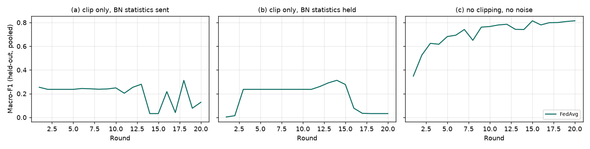

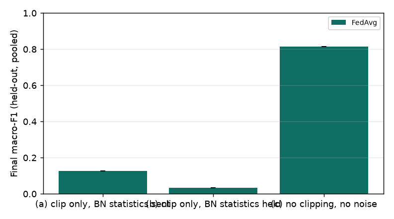

### 5b. FedProx vs FedAvg under strong label skew: ECG, MIT-BIH

Dirichlet alpha = 0.1; mu = 0 (FedAvg), 0.01, 0.1.

*Config:* `experiments/configs/mitbih_ecg_fedprox.yaml`. Data: mit-bih ECG, stratified subsample of 25000 records. Partition: dirichlet (alpha = 0.1). 20 rounds × 2 local epochs, batch 32, learning rate 0.003. Seeds: 0, 1, 2. Values are mean ± std over seeds, final round, held-out splits pooled over hospitals.

Records available in mitbih_train.csv + mitbih_test.csv (class Q dropped): 101,407 (N 90,589, S 2,779, V 7,236, F 803). Used: 25,000 (N 22,333, S 685, V 1,784, F 198), a stratified by class, without replacement subsample drawn once with seed 0 and shared by every MIT-BIH experiment and seed.

| Variant | Method | Seeds | Macro-F1 | Accuracy | Recall N | Recall S | Recall V | Recall F |
| --- | --- | --- | --- | --- | --- | --- | --- | --- |
| FedAvg (mu=0) | FedAvg | 3 | 0.452 ± 0.106 | 0.939 ± 0.034 | 0.998 ± 0.001 | 0.000 ± 0.000 | 0.626 ± 0.542 | 0.317 ± 0.433 |
| FedProx mu=0.01 | FedAvg | 3 | 0.406 ± 0.068 | 0.923 ± 0.027 | 0.980 ± 0.026 | 0.000 ± 0.000 | 0.633 ± 0.548 | 0.214 ± 0.371 |
| FedProx mu=0.1 | FedAvg | 3 | 0.354 ± 0.099 | 0.912 ± 0.014 | 0.980 ± 0.020 | 0.000 ± 0.000 | 0.504 ± 0.461 | 0.000 ± 0.000 |

Communication (FedAvg):

| Variant | Upload per hospital per round (MB) | Download per hospital per round (MB) | Total upload, all hospitals and rounds (MB) | Rounds to macro-F1 ≥ 0.8 | Rounds to 95% of centralised macro-F1 |
| --- | --- | --- | --- | --- | --- |
| FedAvg (mu=0) | 0.37 ± 0.00 | 0.74 ± 0.00 | 27.2 ± 4.3 | not reached (0/3) | - |
| FedProx mu=0.01 | 0.37 ± 0.00 | 0.74 ± 0.00 | 27.2 ± 4.3 | not reached (0/3) | - |
| FedProx mu=0.1 | 0.37 ± 0.00 | 0.74 ± 0.00 | 27.2 ± 4.3 | not reached (0/3) | - |

Download counts the round's base model and the aggregated model each hospital fetches to evaluate.

Partition, seed 0 (training records per class at each hospital):

| Variant | Hospital | Train | Held-out | train N | train S | train V | train F |
| --- | --- | --- | --- | --- | --- | --- | --- |
| all variants | hospital_a | 529 | 176 | 0 | 511 | 18 | 0 |
| all variants | hospital_b | 1166 | 388 | 0 | 0 | 1016 | 150 |
| all variants | hospital_c | 17053 | 5684 | 16761 | 0 | 292 | 0 |

Class F beats per hospital, training / held-out, for each seed (the rarest class; its recall rests on these few beats):

| Variant | Hospital | seed 0 | seed 1 | seed 2 |
| --- | --- | --- | --- | --- |
| all variants | hospital_a | 0 / 0 | 0 / 0 | 120 / 40 |
| all variants | hospital_b | 150 / 47 | 156 / 41 | 1 / 0 |
| all variants | hospital_c | 0 / 0 | 0 / 0 | 0 / 0 |
| all variants | hospital_d | excluded | 0 / 1 | 27 / 10 |

Hospitals that sat a run out (too few records to train): FedAvg (mu=0) seed 0 hospital_d (received 4 record(s)); FedProx mu=0.01 seed 0 hospital_d (received 4 record(s)); FedProx mu=0.1 seed 0 hospital_d (received 4 record(s))

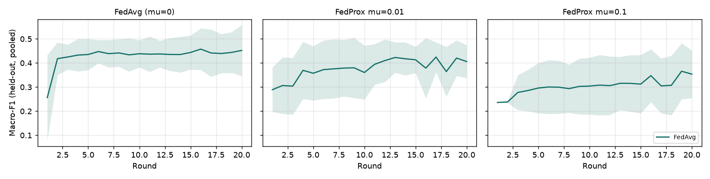

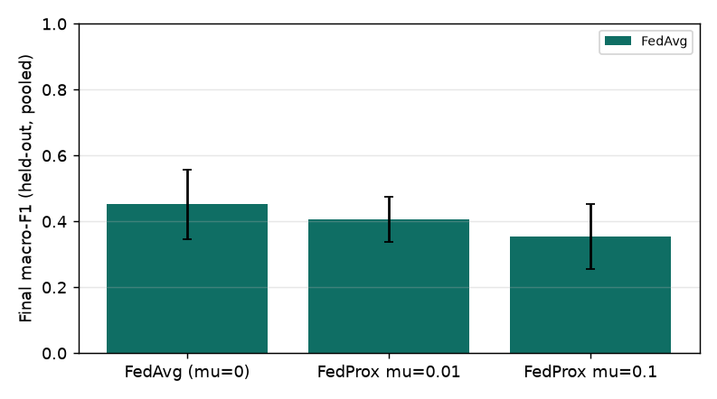

## Part B. Simulated data: pipeline validation, not evidence

These runs check that the experiment pipeline, the methods and the reporting behave as expected on every modality. The simulated hospitals are fictional and the simulators are easy (simulated ECG reaches macro-F1 near 0.99), so a high score here shows that the simulator is easy, not that a method works. Do not cite these numbers as results.

### 1a. Baselines: ECG, simulated hospitals

Each hospital training alone, FedAvg, and a centralised model trained offline on the union of the same training partitions (an upper bound, not part of the platform). The four simulated hospitals keep their own data distributions ("natural" partition, as on the platform).

*Config:* `experiments/configs/sim_ecg_baselines.yaml`. Data: simulated ECG. Partition: natural. 30 rounds × 2 local epochs, batch 32, learning rate 0.003. Seeds: 0, 1, 2. Values are mean ± std over seeds, final round, held-out splits pooled over hospitals.

| Variant | Method | Seeds | Macro-F1 | Accuracy | Recall N | Recall S | Recall V | Recall F |
| --- | --- | --- | --- | --- | --- | --- | --- | --- |
| default | Local only, own hospital's share | 3 | 0.969 ± 0.029 | 0.986 ± 0.010 | 0.998 ± 0.004 | 0.973 ± 0.018 | 1.000 ± 0.000 | 0.872 ± 0.126 |
| default | Local only, all hospitals' held-out data | 3 | 0.955 ± 0.022 | - | - | - | - | - |
| default | FedAvg | 3 | 0.987 ± 0.004 | 0.995 ± 0.001 | 1.000 ± 0.000 | 0.994 ± 0.011 | 1.000 ± 0.000 | 0.932 ± 0.026 |
| default | Centralised (upper bound) | 3 | 1.000 ± 0.000 | 1.000 ± 0.000 | 1.000 ± 0.000 | 1.000 ± 0.000 | 1.000 ± 0.000 | 1.000 ± 0.000 |

*Local only, all hospitals' held-out data*: each hospital's final local model scored on every hospital's held-out records, pooled over the four models. It answers whether one hospital's model generalises to the other hospitals' patients. A dash means the metric was not recorded for that run.

Communication (FedAvg):

| Variant | Upload per hospital per round (MB) | Download per hospital per round (MB) | Total upload, all hospitals and rounds (MB) | Rounds to macro-F1 ≥ 0.9 | Rounds to 95% of centralised macro-F1 |
| --- | --- | --- | --- | --- | --- |
| default | 0.37 ± 0.00 | 0.74 ± 0.00 | 44.5 ± 0.0 | 4.7 ± 0.6 | 6.0 ± 1.7 |

Download counts the round's base model and the aggregated model each hospital fetches to evaluate.

Partition, seed 0 (training records per class at each hospital):

| Variant | Hospital | Train | Held-out | train N | train S | train V | train F |
| --- | --- | --- | --- | --- | --- | --- | --- |
| all variants | hospital_a | 480 | 160 | 334 | 50 | 78 | 18 |
| all variants | hospital_b | 390 | 130 | 236 | 70 | 69 | 15 |
| all variants | hospital_c | 315 | 105 | 257 | 15 | 30 | 13 |
| all variants | hospital_d | 270 | 90 | 133 | 42 | 67 | 28 |

Class F beats per hospital, training / held-out, for each seed (the rarest class; its recall rests on these few beats):

| Variant | Hospital | seed 0 | seed 1 | seed 2 |
| --- | --- | --- | --- | --- |
| default | hospital_a | 18 / 12 | 29 / 10 | 20 / 10 |
| default | hospital_b | 15 / 7 | 15 / 4 | 12 / 14 |
| default | hospital_c | 13 / 2 | 10 / 5 | 12 / 8 |
| default | hospital_d | 28 / 12 | 22 / 12 | 27 / 11 |

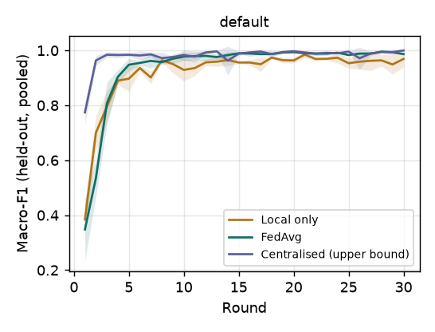

### 1b. Baselines: EHR, simulated hospitals, with and without class-weighted loss

EHR is imbalanced (about 18% adverse outcomes). Class-weighted cross-entropy is an experiment variable here, not a change to the platform: "balanced" weights each class by n / (2 n_class), computed by every hospital from its own training labels (the centralised model uses the union).

*Config:* `experiments/configs/sim_ehr_baselines.yaml`. Data: simulated EHR. Partition: natural. 30 rounds × 2 local epochs, batch 32, learning rate 0.003. Seeds: 0, 1, 2. Values are mean ± std over seeds, final round, held-out splits pooled over hospitals.

| Variant | Method | Seeds | Macro-F1 | Accuracy | F1 (positive) | Recall no adverse outcome | Recall adverse outcome |
| --- | --- | --- | --- | --- | --- | --- | --- |
| unweighted loss | Local only, own hospital's share | 3 | 0.655 ± 0.011 | 0.832 ± 0.008 | 0.407 ± 0.017 | 0.937 ± 0.005 | 0.333 ± 0.015 |
| unweighted loss | Local only, all hospitals' held-out data | 3 | 0.658 ± 0.004 | - | - | - | - |
| unweighted loss | FedAvg | 3 | 0.666 ± 0.010 | 0.840 ± 0.006 | 0.425 ± 0.021 | 0.945 ± 0.004 | 0.341 ± 0.020 |
| unweighted loss | Centralised (upper bound) | 3 | 0.677 ± 0.016 | 0.844 ± 0.011 | 0.445 ± 0.040 | 0.944 ± 0.025 | 0.364 ± 0.075 |
| class-weighted loss | Local only, own hospital's share | 3 | 0.658 ± 0.019 | 0.757 ± 0.019 | 0.473 ± 0.024 | 0.785 ± 0.028 | 0.626 ± 0.016 |
| class-weighted loss | Local only, all hospitals' held-out data | 3 | 0.657 ± 0.020 | - | - | - | - |
| class-weighted loss | FedAvg | 3 | 0.660 ± 0.006 | 0.750 ± 0.004 | 0.484 ± 0.014 | 0.766 ± 0.009 | 0.674 ± 0.037 |
| class-weighted loss | Centralised (upper bound) | 3 | 0.661 ± 0.017 | 0.743 ± 0.024 | 0.495 ± 0.016 | 0.747 ± 0.029 | 0.723 ± 0.002 |

*Local only, all hospitals' held-out data*: each hospital's final local model scored on every hospital's held-out records, pooled over the four models. It answers whether one hospital's model generalises to the other hospitals' patients. A dash means the metric was not recorded for that run.

Communication (FedAvg):

| Variant | Upload per hospital per round (MB) | Download per hospital per round (MB) | Total upload, all hospitals and rounds (MB) | Rounds to macro-F1 ≥ 0.6 | Rounds to 95% of centralised macro-F1 |
| --- | --- | --- | --- | --- | --- |
| unweighted loss | 0.13 ± 0.00 | 0.27 ± 0.00 | 16.0 ± 0.0 | 6.3 ± 1.5 | 10.0 ± 3.0 |
| class-weighted loss | 0.13 ± 0.00 | 0.27 ± 0.00 | 16.0 ± 0.0 | 3.3 ± 0.6 | 4.7 ± 2.9 |

Download counts the round's base model and the aggregated model each hospital fetches to evaluate.

Partition, seed 0 (training records per class at each hospital):

| Variant | Hospital | Train | Held-out | train neg | train pos |
| --- | --- | --- | --- | --- | --- |
| all variants | hospital_a | 900 | 300 | 712 | 188 |
| all variants | hospital_b | 690 | 230 | 596 | 94 |
| all variants | hospital_c | 510 | 170 | 412 | 98 |
| all variants | hospital_d | 390 | 130 | 303 | 87 |

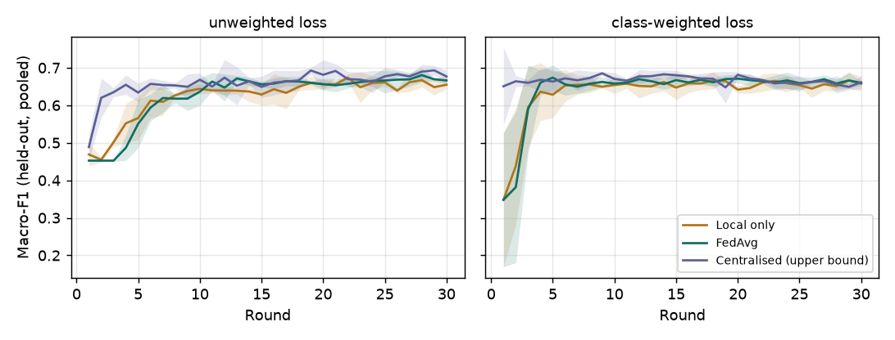

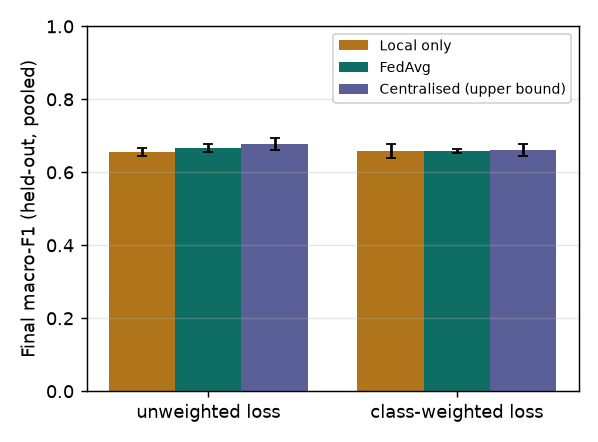

### 1c. Baselines: X-ray, simulated hospitals

EfficientNet-B3 from random initialisation on 64x64 simulated phantoms. 10 rounds only: one round takes about 30 s per method on CPU.

*Config:* `experiments/configs/sim_xray_baselines.yaml`. Data: simulated XRAY. Partition: natural. 10 rounds × 2 local epochs, batch 32, learning rate 0.003. Seeds: 0, 1, 2. Values are mean ± std over seeds, final round, held-out splits pooled over hospitals.

| Variant | Method | Seeds | Macro-F1 | Accuracy | F1 (positive) | Recall no finding | Recall finding |
| --- | --- | --- | --- | --- | --- | --- | --- |
| default | Local only, own hospital's share | 3 | 0.594 ± 0.067 | 0.616 ± 0.082 | 0.507 ± 0.039 | 0.697 ± 0.142 | 0.490 ± 0.018 |
| default | Local only, all hospitals' held-out data | 3 | 0.526 ± 0.063 | - | - | - | - |
| default | FedAvg | 3 | 0.527 ± 0.136 | 0.613 ± 0.020 | 0.361 ± 0.324 | 0.759 ± 0.234 | 0.401 ± 0.401 |
| default | Centralised (upper bound) | 3 | 0.982 ± 0.021 | 0.983 ± 0.021 | 0.979 ± 0.024 | 0.975 ± 0.037 | 0.993 ± 0.012 |

*Local only, all hospitals' held-out data*: each hospital's final local model scored on every hospital's held-out records, pooled over the four models. It answers whether one hospital's model generalises to the other hospitals' patients. A dash means the metric was not recorded for that run.

Communication (FedAvg):

| Variant | Upload per hospital per round (MB) | Download per hospital per round (MB) | Total upload, all hospitals and rounds (MB) | Rounds to macro-F1 ≥ 0.6 | Rounds to 95% of centralised macro-F1 |
| --- | --- | --- | --- | --- | --- |
| default | 43.33 ± 0.00 | 86.65 ± 0.00 | 1733.1 ± 0.0 | 8.5 ± 2.1 (2/3 seeds) | not reached (0/3) |

Download counts the round's base model and the aggregated model each hospital fetches to evaluate.

Partition, seed 0 (training records per class at each hospital):

| Variant | Hospital | Train | Held-out | train no_finding | train finding |
| --- | --- | --- | --- | --- | --- |
| all variants | hospital_a | 240 | 80 | 135 | 105 |
| all variants | hospital_b | 195 | 65 | 121 | 74 |
| all variants | hospital_c | 165 | 55 | 123 | 42 |
| all variants | hospital_d | 150 | 50 | 80 | 70 |

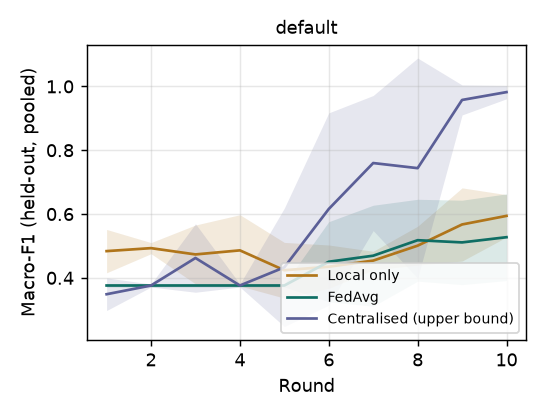

### 2. Non-IID label skew: ECG, simulated

All simulated ECG records are pooled and re-split across the four hospitals with a Dirichlet label split (the same partition_groups function scripts/prepare_real_data.py uses). alpha = inf is an even random split (IID); smaller alpha gives each hospital fewer classes.

*Config:* `experiments/configs/sim_ecg_noniid.yaml`. Data: simulated ECG. Partition: dirichlet (alpha = None). 30 rounds × 2 local epochs, batch 32, learning rate 0.003. Seeds: 0, 1, 2. Values are mean ± std over seeds, final round, held-out splits pooled over hospitals.

| Variant | Method | Seeds | Macro-F1 | Accuracy | Recall N | Recall S | Recall V | Recall F |
| --- | --- | --- | --- | --- | --- | --- | --- | --- |
| alpha=inf | Local only, own hospital's share | 3 | 0.971 ± 0.006 | 0.986 ± 0.005 | 0.994 ± 0.005 | 0.990 ± 0.017 | 0.985 ± 0.019 | 0.911 ± 0.047 |
| alpha=inf | Local only, all hospitals' held-out data | 3 | 0.963 ± 0.009 | - | - | - | - | - |
| alpha=inf | FedAvg | 3 | 0.991 ± 0.003 | 0.997 ± 0.001 | 1.000 ± 0.000 | 1.000 ± 0.000 | 1.000 ± 0.000 | 0.948 ± 0.020 |
| alpha=inf | Centralised (upper bound) | 3 | 0.986 ± 0.009 | 0.991 ± 0.007 | 0.990 ± 0.011 | 1.000 ± 0.000 | 1.000 ± 0.000 | 0.962 ± 0.034 |
| alpha=1.0 | Local only, own hospital's share | 3 | 0.977 ± 0.018 | 0.986 ± 0.007 | 0.990 ± 0.009 | 0.948 ± 0.074 | 0.996 ± 0.007 | 0.974 ± 0.044 |
| alpha=1.0 | Local only, all hospitals' held-out data | 3 | 0.859 ± 0.119 | - | - | - | - | - |
| alpha=1.0 | FedAvg | 3 | 0.990 ± 0.009 | 0.996 ± 0.004 | 1.000 ± 0.000 | 0.987 ± 0.011 | 1.000 ± 0.000 | 0.949 ± 0.059 |
| alpha=1.0 | Centralised (upper bound) | 3 | 0.995 ± 0.002 | 0.997 ± 0.001 | 0.999 ± 0.002 | 0.987 ± 0.023 | 0.996 ± 0.007 | 1.000 ± 0.000 |
| alpha=0.1 | Local only, own hospital's share | 3 | 0.997 ± 0.002 | 0.997 ± 0.001 | 0.998 ± 0.002 | 0.988 ± 0.010 | 1.000 ± 0.000 | 1.000 ± 0.000 |
| alpha=0.1 | Local only, all hospitals' held-out data | 3 | 0.436 ± 0.102 | - | - | - | - | - |
| alpha=0.1 | FedAvg | 3 | 0.698 ± 0.128 | 0.874 ± 0.080 | 0.999 ± 0.002 | 0.661 ± 0.572 | 0.667 ± 0.577 | 0.654 ± 0.343 |
| alpha=0.1 | Centralised (upper bound) | 3 | 0.990 ± 0.009 | 0.997 ± 0.003 | 0.999 ± 0.002 | 0.995 ± 0.009 | 0.996 ± 0.007 | 0.976 ± 0.041 |

*Local only, all hospitals' held-out data*: each hospital's final local model scored on every hospital's held-out records, pooled over the four models. It answers whether one hospital's model generalises to the other hospitals' patients. A dash means the metric was not recorded for that run.

Communication (FedAvg):

| Variant | Upload per hospital per round (MB) | Download per hospital per round (MB) | Total upload, all hospitals and rounds (MB) | Rounds to macro-F1 ≥ 0.9 | Rounds to 95% of centralised macro-F1 |
| --- | --- | --- | --- | --- | --- |
| alpha=inf | 0.37 ± 0.00 | 0.74 ± 0.00 | 44.5 ± 0.0 | 4.7 ± 0.6 | 6.3 ± 1.5 |
| alpha=1.0 | 0.37 ± 0.00 | 0.74 ± 0.00 | 44.5 ± 0.0 | 5.3 ± 1.5 | 8.0 ± 4.4 |
| alpha=0.1 | 0.37 ± 0.00 | 0.74 ± 0.00 | 44.5 ± 0.0 | 12.0 ± 0.0 (1/3 seeds) | 12.0 ± 0.0 (1/3 seeds) |

Download counts the round's base model and the aggregated model each hospital fetches to evaluate.

Partition, seed 0 (training records per class at each hospital):

| Variant | Hospital | Train | Held-out | train N | train S | train V | train F |
| --- | --- | --- | --- | --- | --- | --- | --- |
| alpha=inf | hospital_a | 364 | 121 | 242 | 48 | 51 | 23 |
| alpha=inf | hospital_b | 364 | 121 | 241 | 41 | 66 | 16 |
| alpha=inf | hospital_c | 364 | 121 | 238 | 41 | 69 | 16 |
| alpha=inf | hospital_d | 364 | 121 | 244 | 50 | 50 | 20 |
| alpha=1.0 | hospital_a | 154 | 52 | 94 | 32 | 10 | 18 |
| alpha=1.0 | hospital_b | 931 | 310 | 760 | 125 | 43 | 3 |
| alpha=1.0 | hospital_c | 224 | 74 | 2 | 17 | 146 | 59 |
| alpha=1.0 | hospital_d | 146 | 49 | 95 | 4 | 46 | 1 |
| alpha=0.1 | hospital_a | 22 | 8 | 10 | 0 | 0 | 12 |
| alpha=0.1 | hospital_b | 62 | 21 | 0 | 0 | 1 | 61 |
| alpha=0.1 | hospital_c | 171 | 57 | 0 | 171 | 0 | 0 |
| alpha=0.1 | hospital_d | 1199 | 400 | 955 | 0 | 238 | 6 |

Class F beats per hospital, training / held-out, for each seed (the rarest class; its recall rests on these few beats):

| Variant | Hospital | seed 0 | seed 1 | seed 2 |
| --- | --- | --- | --- | --- |
| alpha=inf | hospital_a | 23 / 6 | 17 / 11 | 24 / 3 |
| alpha=inf | hospital_b | 16 / 10 | 12 / 14 | 25 / 10 |
| alpha=inf | hospital_c | 16 / 6 | 21 / 8 | 22 / 9 |
| alpha=inf | hospital_d | 20 / 10 | 19 / 5 | 15 / 6 |
| alpha=1.0 | hospital_a | 18 / 6 | 51 / 17 | 31 / 10 |
| alpha=1.0 | hospital_b | 3 / 0 | 7 / 1 | 26 / 8 |
| alpha=1.0 | hospital_c | 59 / 19 | 5 / 4 | 30 / 8 |
| alpha=1.0 | hospital_d | 1 / 1 | 18 / 4 | 1 / 0 |
| alpha=0.1 | hospital_a | 12 / 7 | 3 / 1 | 0 / 0 |
| alpha=0.1 | hospital_b | 61 / 21 | 76 / 26 | 85 / 28 |
| alpha=0.1 | hospital_c | 0 / 0 | 0 / 0 | 0 / 0 |
| alpha=0.1 | hospital_d | 6 / 0 | 1 / 0 | 1 / 0 |

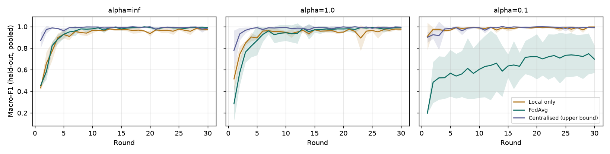

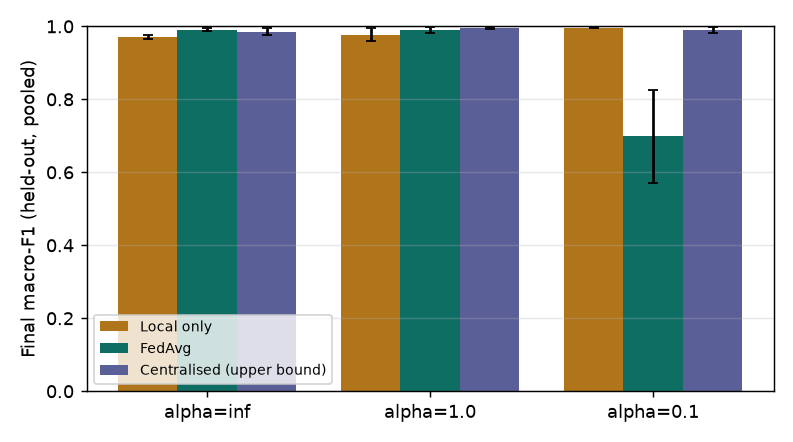

### 3. Privacy cost: ECG, simulated

The platform's prototype DP mechanism inside each hospital node: the update is clipped to an L2 norm of 1.0 (the platform default, fixed for all variants) and Gaussian noise with standard deviation noise_multiplier x clip_norm is added to every coordinate. Epsilon is the platform's zCDP accounting over all rounds (delta = 1e-5); the protected unit is a hospital's whole update, not a patient. noise_multiplier = 0 means DP off (no clipping either). The grid is the union of the first grid (0.5, 1.0, 2.0, run first) and the finer grid used for MIT-BIH; no level was dropped.

*Config:* `experiments/configs/sim_ecg_privacy.yaml`. Data: simulated ECG. Partition: natural. 30 rounds × 2 local epochs, batch 32, learning rate 0.003. Seeds: 0, 1, 2. Values are mean ± std over seeds, final round, held-out splits pooled over hospitals.

| Variant | Method | Seeds | Macro-F1 | Accuracy | Recall N | Recall S | Recall V | Recall F |
| --- | --- | --- | --- | --- | --- | --- | --- | --- |
| sigma=0 (no DP) | FedAvg | 3 | 0.990 ± 0.011 | 0.996 ± 0.004 | 1.000 ± 0.000 | 0.994 ± 0.011 | 1.000 ± 0.000 | 0.949 ± 0.069 |
| sigma=0.001 | FedAvg | 3 | 0.977 ± 0.013 | 0.989 ± 0.005 | 0.999 ± 0.002 | 0.973 ± 0.018 | 0.996 ± 0.007 | 0.908 ± 0.090 |
| sigma=0.003 | FedAvg | 3 | 0.975 ± 0.024 | 0.990 ± 0.009 | 0.999 ± 0.002 | 0.989 ± 0.010 | 0.996 ± 0.007 | 0.886 ± 0.126 |
| sigma=0.01 | FedAvg | 3 | 0.980 ± 0.009 | 0.990 ± 0.005 | 0.999 ± 0.002 | 0.976 ± 0.030 | 0.996 ± 0.007 | 0.921 ± 0.044 |
| sigma=0.03 | FedAvg | 3 | 0.986 ± 0.007 | 0.992 ± 0.003 | 1.000 ± 0.000 | 0.972 ± 0.011 | 0.996 ± 0.007 | 0.950 ± 0.041 |
| sigma=0.1 | FedAvg | 3 | 0.678 ± 0.107 | 0.841 ± 0.040 | 0.945 ± 0.048 | 0.470 ± 0.164 | 0.963 ± 0.054 | 0.324 ± 0.281 |
| sigma=0.5 | FedAvg | 3 | 0.172 ± 0.129 | 0.342 ± 0.238 | 0.412 ± 0.312 | 0.005 ± 0.009 | 0.322 ± 0.558 | 0.248 ± 0.430 |
| sigma=1.0 | FedAvg | 3 | 0.208 ± 0.062 | 0.276 ± 0.141 | 0.201 ± 0.218 | 0.407 ± 0.399 | 0.472 ± 0.413 | 0.178 ± 0.309 |
| sigma=2.0 | FedAvg | 3 | 0.167 ± 0.042 | 0.258 ± 0.025 | 0.200 ± 0.060 | 0.172 ± 0.298 | 0.587 ± 0.509 | 0.131 ± 0.227 |

Privacy accounting (platform's zCDP bound, per hospital, over all rounds):

| Variant | ε | Macro-F1 | Accuracy | Median update norm before clipping | Share of updates clipped |
| --- | --- | --- | --- | --- | --- |
| sigma=0 (no DP) | ∞ | 0.990 ± 0.011 | 0.996 ± 0.004 | 3.35 ± 0.39 | 0.00 ± 0.00 |
| sigma=0.001 | 15026282.61 ± 0.00 | 0.977 ± 0.013 | 0.989 ± 0.005 | 3.70 ± 0.04 | 1.00 ± 0.00 |
| sigma=0.003 | 1675427.54 ± 0.00 | 0.975 ± 0.024 | 0.990 ± 0.009 | 3.54 ± 0.07 | 1.00 ± 0.00 |
| sigma=0.01 | 152628.26 ± 0.00 | 0.980 ± 0.009 | 0.990 ± 0.005 | 3.58 ± 0.14 | 1.00 ± 0.00 |
| sigma=0.03 | 17542.75 ± 0.00 | 0.986 ± 0.007 | 0.992 ± 0.003 | 3.89 ± 0.06 | 1.00 ± 0.00 |
| sigma=0.1 | 1762.83 ± 0.00 | 0.678 ± 0.107 | 0.841 ± 0.040 | 4.48 ± 0.07 | 1.00 ± 0.00 |
| sigma=0.5 | 112.57 ± 0.00 | 0.172 ± 0.129 | 0.342 ± 0.238 | 4.87 ± 0.10 | 1.00 ± 0.00 |
| sigma=1.0 | 41.28 ± 0.00 | 0.208 ± 0.062 | 0.276 ± 0.141 | 4.59 ± 0.03 | 1.00 ± 0.00 |
| sigma=2.0 | 16.89 ± 0.00 | 0.167 ± 0.042 | 0.258 ± 0.025 | 4.62 ± 0.17 | 1.00 ± 0.00 |

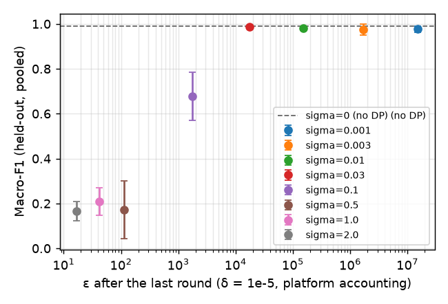

Communication (FedAvg):

| Variant | Upload per hospital per round (MB) | Download per hospital per round (MB) | Total upload, all hospitals and rounds (MB) | Rounds to macro-F1 ≥ 0.9 | Rounds to 95% of centralised macro-F1 |
| --- | --- | --- | --- | --- | --- |
| sigma=0 (no DP) | 0.37 ± 0.00 | 0.74 ± 0.00 | 44.5 ± 0.0 | 5.0 ± 0.0 | - |
| sigma=0.001 | 0.37 ± 0.00 | 0.74 ± 0.00 | 44.5 ± 0.0 | 15.0 ± 0.0 | - |
| sigma=0.003 | 0.37 ± 0.00 | 0.74 ± 0.00 | 44.5 ± 0.0 | 15.0 ± 1.7 | - |
| sigma=0.01 | 0.37 ± 0.00 | 0.74 ± 0.00 | 44.5 ± 0.0 | 14.3 ± 1.2 | - |
| sigma=0.03 | 0.37 ± 0.00 | 0.74 ± 0.00 | 44.5 ± 0.0 | 15.3 ± 0.6 | - |
| sigma=0.1 | 0.37 ± 0.00 | 0.74 ± 0.00 | 44.5 ± 0.0 | 27.0 ± 0.0 (1/3 seeds) | - |
| sigma=0.5 | 0.37 ± 0.00 | 0.74 ± 0.00 | 44.5 ± 0.0 | not reached (0/3) | - |
| sigma=1.0 | 0.37 ± 0.00 | 0.74 ± 0.00 | 44.5 ± 0.0 | not reached (0/3) | - |
| sigma=2.0 | 0.37 ± 0.00 | 0.74 ± 0.00 | 44.5 ± 0.0 | not reached (0/3) | - |

Download counts the round's base model and the aggregated model each hospital fetches to evaluate.

Partition, seed 0 (training records per class at each hospital):

| Variant | Hospital | Train | Held-out | train N | train S | train V | train F |
| --- | --- | --- | --- | --- | --- | --- | --- |
| all variants | hospital_a | 480 | 160 | 334 | 50 | 78 | 18 |
| all variants | hospital_b | 390 | 130 | 236 | 70 | 69 | 15 |
| all variants | hospital_c | 315 | 105 | 257 | 15 | 30 | 13 |
| all variants | hospital_d | 270 | 90 | 133 | 42 | 67 | 28 |

Class F beats per hospital, training / held-out, for each seed (the rarest class; its recall rests on these few beats):

| Variant | Hospital | seed 0 | seed 1 | seed 2 |
| --- | --- | --- | --- | --- |
| all variants | hospital_a | 18 / 12 | 29 / 10 | 20 / 10 |
| all variants | hospital_b | 15 / 7 | 15 / 4 | 12 / 14 |
| all variants | hospital_c | 13 / 2 | 10 / 5 | 12 / 8 |
| all variants | hospital_d | 28 / 12 | 22 / 12 | 27 / 11 |

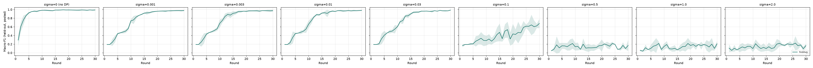

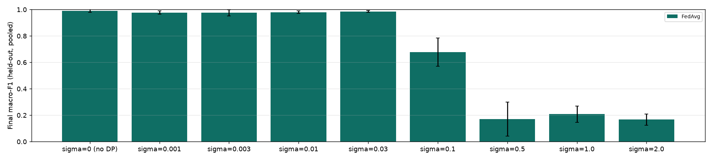

### 5. FedProx vs FedAvg under strong label skew: ECG, simulated

alpha = 0.1 Dirichlet label split. FedProx adds mu/2 ||w - w_global||^2 to each hospital's local loss; mu = 0 is FedAvg. Aggregation is the same FedAvg weighted average in all three.

*Config:* `experiments/configs/sim_ecg_fedprox.yaml`. Data: simulated ECG. Partition: dirichlet (alpha = 0.1). 30 rounds × 2 local epochs, batch 32, learning rate 0.003. Seeds: 0, 1, 2. Values are mean ± std over seeds, final round, held-out splits pooled over hospitals.

| Variant | Method | Seeds | Macro-F1 | Accuracy | Recall N | Recall S | Recall V | Recall F |
| --- | --- | --- | --- | --- | --- | --- | --- | --- |
| FedAvg (mu=0) | FedAvg | 3 | 0.715 ± 0.146 | 0.876 ± 0.083 | 1.000 ± 0.000 | 0.626 ± 0.544 | 0.667 ± 0.577 | 0.738 ± 0.338 |
| FedProx mu=0.01 | FedAvg | 3 | 0.656 ± 0.259 | 0.843 ± 0.141 | 0.995 ± 0.007 | 0.374 ± 0.545 | 0.727 ± 0.473 | 0.527 ± 0.246 |
| FedProx mu=0.1 | FedAvg | 3 | 0.596 ± 0.161 | 0.848 ± 0.094 | 0.998 ± 0.002 | 0.333 ± 0.577 | 0.855 ± 0.252 | 0.230 ± 0.106 |

Communication (FedAvg):

| Variant | Upload per hospital per round (MB) | Download per hospital per round (MB) | Total upload, all hospitals and rounds (MB) | Rounds to macro-F1 ≥ 0.9 | Rounds to 95% of centralised macro-F1 |
| --- | --- | --- | --- | --- | --- |
| FedAvg (mu=0) | 0.37 ± 0.00 | 0.74 ± 0.00 | 44.5 ± 0.0 | 13.0 ± 0.0 (1/3 seeds) | - |
| FedProx mu=0.01 | 0.37 ± 0.00 | 0.74 ± 0.00 | 44.5 ± 0.0 | 20.0 ± 0.0 (1/3 seeds) | - |
| FedProx mu=0.1 | 0.37 ± 0.00 | 0.74 ± 0.00 | 44.5 ± 0.0 | not reached (0/3) | - |

Download counts the round's base model and the aggregated model each hospital fetches to evaluate.

Partition, seed 0 (training records per class at each hospital):

| Variant | Hospital | Train | Held-out | train N | train S | train V | train F |
| --- | --- | --- | --- | --- | --- | --- | --- |
| all variants | hospital_a | 22 | 8 | 10 | 0 | 0 | 12 |
| all variants | hospital_b | 62 | 21 | 0 | 0 | 1 | 61 |
| all variants | hospital_c | 171 | 57 | 0 | 171 | 0 | 0 |
| all variants | hospital_d | 1199 | 400 | 955 | 0 | 238 | 6 |

Class F beats per hospital, training / held-out, for each seed (the rarest class; its recall rests on these few beats):

| Variant | Hospital | seed 0 | seed 1 | seed 2 |
| --- | --- | --- | --- | --- |
| all variants | hospital_a | 12 / 7 | 3 / 1 | 0 / 0 |
| all variants | hospital_b | 61 / 21 | 76 / 26 | 85 / 28 |
| all variants | hospital_c | 0 / 0 | 0 / 0 | 0 / 0 |
| all variants | hospital_d | 6 / 0 | 1 / 0 | 1 / 0 |

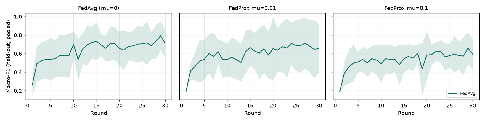

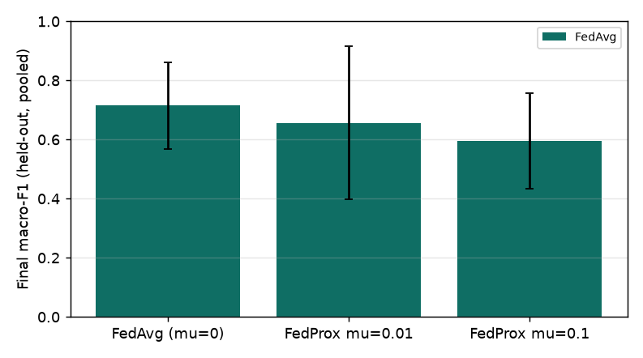

## Part C. Surveillance forecasting (simulated)

Forecasts of weekly case counts per region and disease, the ones the dashboard shows. The series are simulated (the same generator as the demo), so this part checks the forecasting pipeline and compares models on one simulated dataset; it is not evidence about real outbreaks.

### Surveillance forecasting (simulated): weekly case counts per region and disease, 1-4 weeks ahead

Fixed before any run. Data: the SIMULATED weekly hospital reports the demo uses (12 simulated regions, 4 hospitals, 3 diseases, 104 weeks ending on the fixed week below, seed 2024, cells under 5 suppressed), aggregated to one series per region and disease (36 series). A regional week with a suppressed hospital cell has no total; such weeks are filled from earlier weeks only when they are inputs and are skipped when they are targets. As in the live forecast, a series is not forecast when more than 20% of its weeks are missing; the share is measured on weeks 1-64 only (the rule is fixed here, before any run). Week numbers count from 1 (the oldest week). Fitting window: weeks 1-64. Validation: forecasts whose target falls in weeks 65-84. Test: forecasts whose target falls in weeks 85-104. Every model is refitted at every forecast origin on all weeks up to and including that origin (rolling origin, expanding window), and forecasts 1-4 weeks ahead; only targets inside the window being scored count. Ensemble weights and the empirical intervals (LSTM, ensemble) use validation forecasts only and are frozen before the test window is scored. All forecasts and interval bounds are clipped at 0 (counts cannot be negative). Reported per model and horizon on the test window: MAE, RMSE, 80% interval coverage, and the MAE ratio against seasonal naive at the same horizon (below 1 = better than seasonal naive). The ensemble is not called better than its members unless the table shows it. One run; the LSTM uses a fixed seed.

*Config:* `experiments/configs/surveillance_forecasting.yaml`. Data: 26 SIMULATED series (10 excluded by the missing-weeks rule: acute_gastroenteritis:R02, acute_gastroenteritis:R03, acute_gastroenteritis:R07, acute_gastroenteritis:R08, acute_gastroenteritis:R09, acute_gastroenteritis:R10, acute_gastroenteritis:R12, dengue:R02, dengue:R08, influenza_like_illness:R02), weeks 2024-11-04 to 2026-10-26. Origins: weeks 61-103. One run (LSTM seed 0, 4 PyTorch threads).

**These results apply to the 26 series with enough reported weeks, not to all 36.** The 10 excluded series were mostly suppressed small counts: 20%-91% of their weeks 1-64 have no regional total because a hospital's count was below the suppression threshold, and their median weekly count is 22.5, against 0%-14% missing and a median of 56.5 for the series that were forecast. How the models would do on those sparse series was not measured.

Test window (targets in weeks 85-104), horizons 1-4 pooled, 2008 forecasts per model:

| Model | MAE | RMSE | 80% interval coverage | MAE ratio vs seasonal naive | Median of per-series MAE ratios | Series better than seasonal naive |
| --- | --- | --- | --- | --- | --- | --- |
| Naive (last value) | 17.07 | 26.29 | 0.870 | 0.931 | 0.968 | 16 of 26 |
| Seasonal naive (52 weeks) | 18.34 | 28.99 | 0.741 | 1.000 | 1.000 | 0 of 26 |
| ARIMA(p,d,0), least squares | 18.36 | 28.10 | 0.757 | 1.001 | 0.951 | 14 of 26 |
| Seasonal ARIMA(1,0,0)(0,1,0)[52], least squares | 17.85 | 27.76 | 0.743 | 0.973 | 0.996 | 14 of 26 |
| ARIMA(2,1,1), statsmodels | 16.41 | 26.19 | 0.754 | 0.895 | 0.906 | 17 of 26 |
| Prophet | 16.54 | 26.88 | 0.581 | 0.902 | 0.883 | 21 of 26 |
| LSTM (global) | 15.35 | 26.16 | 0.747 | 0.837 | 0.853 | 20 of 26 |
| Ensemble (ARIMA + Prophet + LSTM) | 14.52 | 24.85 | 0.736 | 0.792 | 0.798 | 24 of 26 |

The pooled MAE ratio weights each series by its size, so large series count for more. The median of per-series ratios (each series' MAE divided by seasonal naive's MAE on the same series, horizons 1-4 pooled) gives every series one vote; below 1 means the model beat seasonal naive on the typical series.

By horizon (MAE / 80% coverage / MAE ratio vs seasonal naive):

| Model | 1 week ahead | 2 weeks ahead | 3 weeks ahead | 4 weeks ahead |
| --- | --- | --- | --- | --- |
| Naive (last value) | 14.98 / 0.771 / 0.817 | 16.31 / 0.869 / 0.890 | 17.75 / 0.912 / 0.968 | 19.24 / 0.928 / 1.049 |
| Seasonal naive (52 weeks) | 18.34 / 0.745 / 1.000 | 18.34 / 0.741 / 1.000 | 18.34 / 0.739 / 1.000 | 18.34 / 0.737 / 1.000 |
| ARIMA(p,d,0), least squares | 14.58 / 0.751 / 0.795 | 17.09 / 0.765 / 0.932 | 19.54 / 0.767 / 1.066 | 22.25 / 0.745 / 1.213 |
| Seasonal ARIMA(1,0,0)(0,1,0)[52], least squares | 17.18 / 0.737 / 0.937 | 17.77 / 0.749 / 0.969 | 18.15 / 0.745 / 0.990 | 18.30 / 0.739 / 0.998 |
| ARIMA(2,1,1), statsmodels | 13.95 / 0.757 / 0.761 | 15.56 / 0.749 / 0.848 | 17.19 / 0.761 / 0.938 | 18.94 / 0.751 / 1.033 |
| Prophet | 15.13 / 0.627 / 0.825 | 16.57 / 0.590 / 0.904 | 17.19 / 0.546 / 0.937 | 17.25 / 0.560 / 0.941 |
| LSTM (global) | 14.31 / 0.733 / 0.780 | 15.03 / 0.727 / 0.820 | 15.61 / 0.757 / 0.851 | 16.45 / 0.771 / 0.897 |
| Ensemble (ARIMA + Prophet + LSTM) | 13.30 / 0.723 / 0.725 | 14.40 / 0.743 / 0.785 | 14.92 / 0.737 / 0.814 | 15.46 / 0.739 / 0.843 |

Ensemble weights, fitted on the validation window only (each row sums to 1):

| Horizon | ARIMA(2,1,1), statsmodels | Prophet | LSTM (global) | Validation forecasts |
| --- | --- | --- | --- | --- |
| 1 | 0.343 | 0.350 | 0.308 | 482 |
| 2 | 0.235 | 0.356 | 0.409 | 482 |
| 3 | 0.255 | 0.439 | 0.306 | 482 |
| 4 | 0.184 | 0.491 | 0.325 | 482 |

Fits that failed (counted per series and origin; a failed fit has no forecast, and only forecasts that every model produced are scored): Seasonal ARIMA(1,0,0)(0,1,0)[52], least squares 78.

Coverage is the share of test targets inside the 80% interval (0.8 is the target). Intervals: the models' own for the statistical models and Prophet; for the LSTM and the ensemble, the 10th and 90th percentiles of their scaled validation errors. All values come from the run above; nothing was tuned on the test window. The series are simulated, so this checks the forecasting pipeline, not real-world accuracy.

### Hotspot precision from recorded alert outcomes

An alert opens when a region becomes a potential hotspot; a health officer acknowledges it and records whether the rise was confirmed, not confirmed, or a reporting artefact. Precision = confirmed / all recorded outcomes; the second figure leaves reporting artefacts out (confirmed / (confirmed + not confirmed)). Alerts without a recorded outcome are not counted.

| Alerts from | Alerts raised | Outcomes recorded | Confirmed | Not confirmed | Reporting artefact | Precision | Precision without artefacts |
| --- | --- | --- | --- | --- | --- | --- | --- |
| **Simulated data (DEMO OUTCOMES)** | 27 | 3 | 1 | 1 | 1 | 0.33 | 0.50 |
| Real data | 0 | 0 | 0 | 0 | 0 | - | - |

**The simulated-data row uses demo outcomes.** They were entered by hand during a demo walk-through of the alert workflow, not found by investigating anything, and the rises they refer to were injected by the simulator. The figures check that outcomes are recorded and counted correctly; they say nothing about how often the detector is right. Precision on real data needs real alerts with outcomes established by health officers.

## Known issues

Recorded as they were noticed. Nothing listed here was rerun or changed after the fact; each item is left
for the project owner to decide.

1. **The laptop slept twice during the MIT-BIH runs** (around 17:50 and 18:12 on 1 Nov 2026). Running
   processes paused and resumed. This affects only wall-clock time, which is not reported from these runs
   (see *Run time*); rounds are computed identically before and after a pause.
2. **No +P (precision) for the Kaggle MIT-BIH and simulated runs.** Per-class precision was added to the
   harness for the patient-wise setting after those runs had started, so their Se / +P tables show a dash
   for +P. Their recall (= Se) is recorded. These runs did not save confusion matrices either, and +P cannot
   be reconstructed from what they did save: per-class recall and the held-out class counts give each
   class's true positives, but not its false positives (four unknowns for the four ECG classes, against two
   constraints from accuracy and macro-F1). Getting +P for these settings would need a rerun.
3. **The same setting gives slightly different FedAvg results in two experiments.** Kaggle MIT-BIH
   baselines (1d) and non-IID alpha = 1.0 (2b) use identical data, partitions and seeds: their local-only
   and centralised results are identical, but FedAvg gives macro-F1 0.842 ± 0.023 in 1d and
   0.829 ± 0.036 in 2b. Likewise FedAvg at alpha = 0.1 gives 0.430 ± 0.079 in 2b and 0.452 ± 0.106 as the
   mu = 0 row of 5b. Cause: `HospitalNode` derives each hospital's shuffling seed from the round id, and the
   harness puts the experiment's name in the round id, so the same seed trains with a different data order
   in each experiment. Nothing is wrong in either run; the gap shows how much FedAvg moves with training
   order alone, beyond the three seeds. Removing the name from the round id would make the two identical.
4. **On MIT-BIH, the small-noise DP points measure clipping, not noise.** With C = 1.0, every update was
   clipped (median norm before clipping about 11). At sigma = 0.001-0.03 every seed ends up predicting class V
   for every beat (V recall 1.000, macro-F1 0.05-0.09), and sigma = 0.1 (0.247) scores higher than sigma =
   0.001 (0.048). In the simulated setting, where updates are smaller (median norm about 3.5), the same
   small-noise levels still learn (macro-F1 0.975-0.986) but need 15 rounds instead of 5 to reach 0.9. A
   one-seed diagnostic (*Diagnostic for known issue 4*, after 3b) then tested whether the cause is that
   batch-norm running statistics are sent unclipped while the weights are clipped. It does not support that:
   with clipping at C = 1.0 and no noise, the model collapses whether the BN statistics are sent (a: final
   macro-F1 0.127, 80% of beats predicted V) or held at the global values (b: 0.032, every beat predicted V),
   while the same run without clipping learns (c: 0.815). Over the 20 rounds, both clip-only runs spend most
   rounds at macro-F1 0.236, which is the score of predicting N for every beat, never exceed 0.32 and then
   drop to predicting mostly or only V; (c) rises steadily. So clipping at C = 1.0 by itself reproduces the
   collapse, and the small-sigma DP rows are confounded by the clip norm, not by BN handling. One seed only;
   no DP row was rerun or changed. The reference (c) did not reproduce 3b's sigma = 0, seed 0 run exactly
   (0.815 against 0.832, with curves that differ from round 1) although the partition and training order were
   the same; the likely cause is that 3b ran with 5 PyTorch threads and the diagnostic with 8, which changes
   floating-point rounding (untested). All three diagnostic variants used 8 threads, so they are comparable
   with each other. A clip norm near the typical update norm would be the next thing to test; C = 1.0 was
   fixed by decision, so that is left for the project owner. Separately, BN statistics fall outside the
   privacy bound (stated in the accounting assumptions).
5. **In the patient-wise setting (1e) the centralised "upper bound" is not an upper bound.** At the final
   round, centralised scores macro-F1 0.372 ± 0.037 against FedAvg's 0.409 ± 0.007. For seeds 0 and 1 its
   curve peaks early (0.462 at round 3, 0.483 at round 4) and ends at 0.340 and 0.364; seed 2 has no early
   peak and ends at 0.413, while FedAvg and local only stay roughly flat at 0.28-0.45 from round 3 onwards;
   none of the curves is still rising at round 20. The protocol reports the final round and has no validation
   set for picking a round (choosing one by DS2 score would be tuning on test data), so the early peak is not
   used. Two consequences for the 1e tables: the "(upper bound)" label did not describe what happened, so 1e
   now labels the method "Centralised (pooled data)" (a label change only; no number changed), and "Rounds to
   95% of centralised macro-F1" (2.0 ± 1.0) compares against a low reference and should not be read as fast
   convergence. Likely explanation: pooled training on DS1 overfits to the 22 training patients, and
   inter-patient generalisation, not the training method, limits all three; untested. Nothing was rerun.
6. **The laptop slept during 1f.** Windows logged a sleep at 10:53 and a wake at 19:51 on 2 Nov 2026, during
   round 7 of the seed 1 pooled run, which took 32,354 s against roughly 40-100 s for its other rounds. As in
   item 1 this affects only wall-clock time, which is not reported from 1f; the rounds are computed
   identically before and after a pause.
7. **1f curves: pooled training peaks early again, and FedAvg moves from round to round.** As in 1e (item 5),
   the pooled model's best macro-F1 comes early (0.498 at round 1, 0.484 and 0.493 at round 3 for seeds 0, 1
   and 2) and it ends at 0.403, 0.409 and 0.429; the final round is reported, as fixed before the run. The
   FedAvg curves are not smooth near the end: at round 19 FedAvg scores 0.433, 0.435 and 0.397 against 0.485,
   0.483 and 0.462 at round 20, and its Se S over rounds 15-20 ranges from 0.10 to 0.21. As a check that
   round 20 does not decide the paired comparison, the same-seed, same-round 1f and 1e FedAvg values were
   compared at each of rounds 15-20: 1f is higher in both macro-F1 and Se S at all 18 seed-round pairs (1e's
   FedAvg Se S never exceeds 0.092 in those rounds). The direction of the paired differences therefore does
   not depend on the round chosen; their size does. This check uses DS2 scores only to describe the curves,
   not to choose what is reported.

## Discussion

Every number below is quoted from the tables above (mean ± std over three seeds, final round). Statements
marked *interpretation* explain a result but were not tested by a separate run.

### What the simulated results show

Part B checks that the pipeline works end to end: data loading, partitioning, local training, FedAvg, DP
clipping and noise, FedProx and the metrics. It is not evidence about medicine. The simulated hospitals are
generated by this project, so how easy they are to learn reflects the generator, not real patients. Simulated
ECG reaches macro-F1 0.987 ± 0.004 with FedAvg and 1.000 ± 0.000 centralised (1a); the simulated EHR task is
harder (FedAvg 0.666 ± 0.010, 1b). In 1b, class weighting moves FedAvg's recall of the adverse outcome from
0.341 ± 0.020 to 0.674 ± 0.037, at the cost of recall on the majority class (0.945 → 0.766), so it is a
working switch, not a free gain. Simulated X-ray ran for 10 rounds only; FedAvg (0.527 ± 0.136) is far below
centralised (0.982 ± 0.021) and has not converged.

### Headline: patient-wise MIT-BIH (1e)

When whole patients are kept apart (DS1 for training, DS2 for testing), every method scores far lower than on
the Kaggle export: FedAvg macro-F1 0.409 ± 0.007, local only 0.371 ± 0.026 on its own hospital's DS2 patients
and 0.359 ± 0.009 on all hospitals' DS2 patients, centralised (pooled data) 0.372 ± 0.037. FedAvg is the best of
the three and has the smallest spread, but no method comes close to the 0.8 target. Centralised ends below
FedAvg; for two of the three seeds its curve peaks early and falls, which is why 1e labels it "pooled data"
rather than "upper bound" (known issue 5). None of the curves is still rising at round 20.

The gap between the two settings is the main real-data finding. The Kaggle numbers (FedAvg 0.842 ± 0.023,
centralised 0.881 ± 0.021 in 1d) come from a split where beats of the same patient can sit on both sides, so
the model can recognise patients rather than arrhythmias. The patient-wise numbers are the ones to quote for
how this model would do on new patients.

Ventricular beats are found reliably; supraventricular beats are not. FedAvg reaches Se V 0.925 ± 0.015 with
+P V 0.487 ± 0.019, but Se S only 0.043 ± 0.018 (+P S 0.091 ± 0.025). For comparison, de Chazal, O'Dwyer
and Reilly (IEEE Trans. Biomed. Eng. 51(7):1196-1206, 2004, doi:10.1109/TBME.2004.827359) report, on the same
DS1 / DS2 split, Se 75.9% and +P 38.5% for SVEB and Se 77.7% and +P 81.9% for VEB. This project's V
sensitivity is higher than theirs but with much lower +P; its S sensitivity is far lower. The comparison is
not like for like: their classifier uses RR-interval features, while this model sees one beat at a time,
whose length is set by the median RR interval of its 10 s window, not by its own RR interval. *Interpretation:*
an S beat differs from a normal beat mainly by arriving early, so a model that cannot see the beat's own RR
interval has little to go on. 1f, added after these results, tests this.

### RR-interval inputs (1f)

1f gives each beat three RR-interval inputs and changes nothing else; 1e stays as reported. Each 1f seed uses
the same records, hospitals and training order as the same 1e seed, so the paired table gives 1f minus 1e
seed by seed.

Under FedAvg, S sensitivity rises in every seed: Δ Se S +0.188, +0.152 and +0.102 (mean +0.147 ± 0.043),
from 0.043 ± 0.018 in 1e to 0.190 ± 0.029. +P S rises more (Δ +0.323 ± 0.067, to 0.413 ± 0.073), so most
beats the model now calls S are S beats. Macro-F1 rises by +0.068 ± 0.010 in the paired comparison (0.409 ±
0.007 to 0.477 ± 0.013), while V changes little (Δ Se V +0.015 ± 0.012, Δ +P V +0.052 ± 0.036) and F stays
near zero. *Interpretation:* most of the macro-F1 gain is the S class, not better N or V.

Pooled training gains too (Δ Se S +0.060 ± 0.030, positive in every seed; Δ macro-F1 +0.042 ± 0.024), but
again ends below FedAvg (0.414 ± 0.013) after an early peak (known issue 7). Local models gain nothing:
Δ macro-F1 +0.003 ± 0.035 and Δ Se S -0.016 ± 0.008 on their own hospital's patients, negative in every
seed. *Interpretation:* the RR inputs only help a model that has seen enough S beats to learn what an early
beat means; a single hospital may hold very few (19 S training beats at hospital_a in seed 0).

The RR inputs help S detection but do not fix it. Se S 0.190 ± 0.029 is still far below the 75.9% de Chazal
et al. report for SVEB on the same split. FedAvg labels 0.017 ± 0.005 of held-out beats as S, while S beats
are about 3.7% of DS2 (1,837 of 49,679 in the beat check), so the model still under-calls S. 1f supports
"RR-interval inputs improve S detection under FedAvg", not "the S limitation is solved". Two caveats: the RR
inputs are divided by the record's average RR, which uses later beats (a deployed system would use a
running average of past beats only), and the FedAvg curves move by several hundredths from round to round,
so the size of the paired differences depends on the final round; their direction does not (known issue 7).

### Class F is high-variance

F recall rests on very few beats, and those beats are concentrated in two patients: record 208 (DS1, about
370 F beats) and record 213 (DS2, about 360). Whichever hospital receives 208 holds nearly all F training
data; whichever receives 213 holds nearly all F test data (see the per-seed F table in 1e, for example seed 1:
hospital_a trains on 373 F beats, hospital_b is tested on 376). Patient-wise F recall is near zero for every
method (FedAvg 0.009 ± 0.012). On the Kaggle export F recall is higher but still has a large spread (FedAvg
0.743 ± 0.080 in 1d). F is reported as recorded, without dropping or merging it, and should be read as
high-variance.

### Label skew (2b) and FedProx (5b)

With mild skew FedAvg holds up (alpha = inf 0.834 ± 0.005, alpha = 1.0 0.829 ± 0.036; centralised 0.879 and
0.881). At alpha = 0.1 it collapses to 0.430 ± 0.079 while centralised stays at 0.850 ± 0.028. The local-only
row shows why the "own share" score is misleading under strong skew: each hospital scores 0.922 ± 0.027 on
its own held-out data because it sees almost only one or two classes, but the same models score 0.362 ± 0.105
on all hospitals' held-out data. Under FedAvg, S recall is 0.000 ± 0.000 in every seed: at seed 0, for
example, hospital_a holds all 511 S training beats of the participating hospitals but only 529 training beats
in all, against 17,053 at hospital_c, and FedAvg weights updates by sample count, so its update is outweighed. *Interpretation:* the class held by one
small hospital is averaged away. Hospital D was excluded at seed 0 (4 records), as the table notes.

FedProx did not help. At alpha = 0.1, mu = 0 gives 0.452 ± 0.106, mu = 0.01 gives 0.406 ± 0.068 and
mu = 0.1 gives 0.354 ± 0.099; the simulated runs (5) show the same order. With three seeds and these spreads
the differences are not clearly significant, but there is no sign of a gain. *Interpretation:* FedProx limits
how far each hospital moves from the global model, which addresses drift between hospitals but not a class
that only one small hospital holds.

### Privacy (3b, 3)

Client-level DP as implemented here (each hospital clips its update to C = 1.0 and adds Gaussian noise of
standard deviation sigma × C to every coordinate) destroys the MIT-BIH model at every noise level tried: from
0.839 ± 0.016 without DP to 0.048-0.247 with DP. The small-sigma points are confounded by clipping (known
issue 4): a one-seed diagnostic after 3b shows that clipping at C = 1.0 with no noise at all already collapses
the model (final macro-F1 0.127 with batch-norm statistics sent, 0.032 with them held, against 0.815 without
clipping), so batch-norm handling is not the cause. Sigma = 0.1 (0.247 ± 0.011, epsilon 1214.6) and sigma = 1.0 (0.175 ± 0.104, epsilon 31.46) are
also far below the non-private model, and neither epsilon is a meaningful privacy guarantee. In the simulated
setting, sigma ≤ 0.03 still learns (0.975-0.986) but sigma = 0.1 drops to 0.678 ± 0.107 and sigma ≥ 0.5 to
0.17-0.21 (epsilon 16.9-112.6).

For the larger noise levels the noise alone is enough, and the reason is arithmetic, not a bug. The update has
d ≈ 90,000 values (0.37 MB at 4 bytes each), so the noise added to one hospital's update has a norm of about
sigma × C × 300, against a clipped signal of at most C. Averaging four hospitals divides the noise standard
deviation by at most 2 (equal weights). At sigma = 1 the noise is about 150 times the signal. Both the noise
and the clipped signal scale with C, so the noise-to-signal ratio is about sigma × √d whatever C is: a clip
norm near the typical update norm (about 11) would remove the clipping confound in the small-sigma rows but
would not change this conclusion. Client-level DP becomes workable when the noise is averaged over thousands
of clients per round, as in cross-device federated learning; with four hospitals it cannot give a useful
epsilon at a usable accuracy. Clip norm and sigma were fixed in advance and not tuned from these results.

Future work: record-level DP (DP-SGD, for example with Opacus) inside each hospital, which protects individual
patients rather than whole hospitals and spreads the noise over each hospital's thousands of beats, and, for client-level DP on this model, a clip
norm near the typical update norm (about 11 here), which was fixed at 1.0 for these runs (known issue 4).

### Communication

Each hospital uploads 0.37 MB per round and downloads 0.74 MB (the round's base model and the aggregated
model). Over 20 rounds and four hospitals that is 29.7 MB of upload in total (27.2 ± 4.3 MB at alpha = 0.1,
where a hospital sat out one run). On the Kaggle split FedAvg needed 12.7 ± 4.5 rounds to reach macro-F1 0.8
(1d); patient-wise it never did. No patient data leaves a hospital; only model weights are sent. Seconds per
round are reported only from the single-process timing run (see *Run time*): on the i7-11800H laptop a
FedAvg round, with all four hospitals simulated in one process, takes 36.6 s patient-wise and 12.8 s on the
Kaggle subsample, about the same as local-only and centralised training of the same data.

### Surveillance forecasting (Part C)

On the simulated test window (weeks 85-104, 2,008 forecasts per model), which covers the 26 series with
enough reported weeks (the 10 excluded series were mostly suppressed small counts), the ensemble of ARIMA(2,1,1), Prophet
and the global LSTM has the lowest pooled MAE (14.52) and RMSE (24.85) in the table, and the lowest MAE at each
horizon from 1 to 4 weeks. Its MAE ratio against seasonal naive is 0.792, against 0.837 for the best single
model (the LSTM) and 0.895 for ARIMA(2,1,1). The gain is not only on large series: the median of
per-series MAE ratios is 0.798, and the ensemble beats seasonal naive on 24 of the 26 series. This is one simulated dataset and one run, and the differences
were not tested for significance, so it shows that the ensemble did best here, not that it will on real
data. No model's 80% interval reaches 80% coverage except naive (0.870): the others lie between 0.736 and
0.757, and Prophet's own interval covers only 0.581. The intervals are therefore too narrow on this data, and
should be read as a lower bound on the uncertainty. The weights fitted on the validation window spread
across all three members (for example 0.343 / 0.350 / 0.308 at one week ahead). Seasonal ARIMA could not be
fitted at the first three origins (78 fits) because it needs 64 weeks of history; those origins only produce
validation forecasts, and every test forecast was scored for every model.

The dashboard still picks one model per region and disease by its own rolling validation, now with Prophet
among the candidates. The global LSTM and the ensemble are evaluated here but are not yet offered on the
dashboard, because they need every series and a validation window, not one series at a time.
